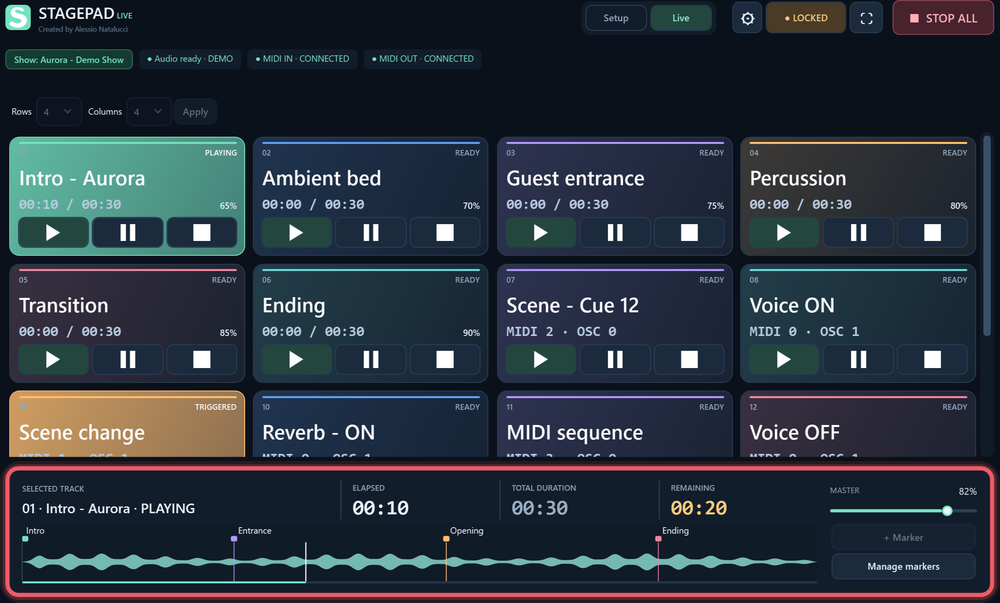
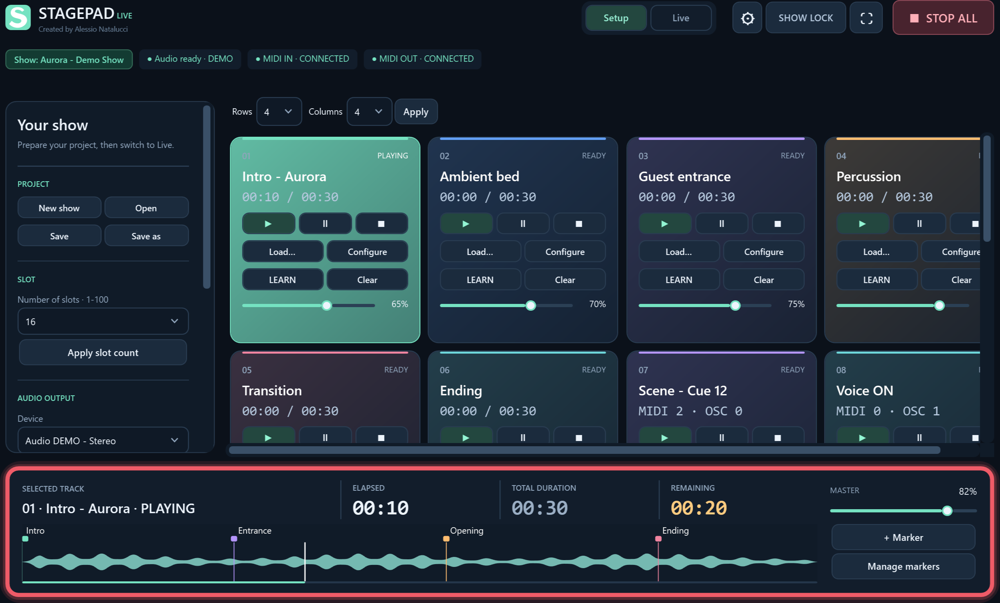
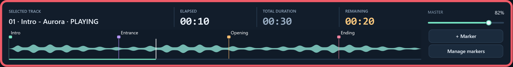

<h1> StagePad Live</h1>

**Audio launcher and MIDI/OSC cue controller for live shows on Windows.**

[](https://github.com/Alessio278/StagePad-Live/releases) [](https://github.com/Alessio278/StagePad-Live/actions/workflows/ci.yml) [](LICENSE)   

[English](README.md) - [Italiano](docs/README.it.md) - [Español](docs/README.es.md) - [Français](docs/README.fr.md)

Created by **Alessio Natalucci**.

## Contents

- [Quick start](#quick-start)
- [Screenshots](#screenshots)
- [Features](#features)
- [Markers and loops](#markers-and-loops)
- [Shows and saving](#shows-and-saving)
- [MIDI and OSC](#midi-and-osc)
- [Build and test](#build-and-test)
- [License and contributions](#license-and-contributions)
- [Windows SmartScreen](#windows-smartscreen)

## Quick start

1. Download **StagePad-Live-1.1-Windows.zip** from [Releases](https://github.com/Alessio278/StagePad-Live/releases), extract it and run **StagePad-1.1.exe**. No installation is needed.
2. In Setup, choose the audio device and MIDI ports. Start with a 40 ms audio buffer and run the audio test.
3. Load audio, configure slot actions and use LEARN to assign MIDI pads. Choose the interface language from the gear icon.
4. Save the show, switch to Live and enable SHOW LOCK. F11 toggles full screen; STOP ALL stops audio and cancels pending commands.

## Screenshots

StagePad Live 1.1 with a demo show. Device connections and command activity are simulated.



<details>
<summary>Setup view</summary>



</details>

[View all 13 screenshots](docs/screenshots/en/README.md)

## Features

| Area | Details |
| --- | --- |
| Pads | 1-100 slots; independent Setup and Live grids, up to 10 x 10 |
| Audio | One-shot, Hold, protected and toggle-pause playback; fades; slot and master volumes |
| Actions | Audio, MIDI and OSC combined, global emergency pause, or exclusive + Marker |
| Control | MIDI LEARN, separate master/track CC assignments, relative encoders and soft takeover |
| Shows | New, Open, Save, Save as, rename, duplicate, delete, auto-save and export with audio |
| Interface | Italian, English, Spanish and French; colored pads, scrolling titles and waveform player |

### New in 1.1

- New shows start with no actions selected. Loading an audio file enables Audio.
- MIDI/OSC commands preload editable defaults. Changing defaults leaves existing commands unchanged.
- Slot volumes show percentages and keep the latest mouse/MIDI value on retrigger and save. A default applies to new slots; applying it to all slots requires stopped tracks.
- Configured pads have a subtle colored tint and brighter activation feedback. MIDI/OSC-only pads show their commands and activation state.
- Emergency slots can require a continuous three-second hold. Use momentary Note On/Off pads so release can cancel the hold.
- Slower wheel/trackpad scrolling, aligned action checkboxes and compact +MARKER labels.

## Markers and loops

Use **+ Marker** in the player to add at the cursor. During playback it inserts without opening the editor. **Manage markers** edits position, label, color and MIDI/OSC triggers. Double-click the waveform or a marker to seek.

A slot can use the exclusive **+ Marker** action; an additional MIDI key can be learned in **Settings > Quick marker insertion**. Both capture on the selected playing track in Setup, with SHOW LOCK off.

Choose two existing markers and press **Apply loop**. Playback starts at the first marker; **Remove loop** clears the interval. Stop the track before changing the loop. During loops the player frame pulses slowly in red; outside loops, marker crossings flash seven times in the marker color. Marker output commands continue on each loop pass.



## Shows and saving

Shows open and save inside the app. Auto-save is on by default, writes in the background and retains the previous file as a `.bak`. Startup restores the last show without starting playback.

The default show folder is `%LOCALAPPDATA%\StagePad\project`; change it in Settings. A JSON show references its audio files. Use **Export show with audio** to move a complete show to another PC.

Version 1.1 reads show schemas 1, 2 and 3 and saves schema 3. Keep backups before upgrading: version 1.0 cannot open schema 3.

## MIDI and OSC

Each slot supports up to 16 MIDI and 16 OSC commands, with order and delays. The two lists run independently. MIDI supports Note, CC, Program Change and MSC; OSC uses UDP with editable host, port, address and typed arguments. A local send count does not confirm receipt.

[MIDI](docs/MIDI.en.md) - [OSC](docs/OSC.en.md) - [Update](docs/UPDATE.en.md)

## Build and test

Requires Windows 10/11 x64 and .NET SDK 10 for building. The portable download includes its runtime. WAV and OGG use included decoders; other formats depend on Windows codecs.

```powershell
.\Build.ps1
```

The script runs core and simulated integration tests, publishes the app, runs native WPF checks and creates the Windows ZIP. Complete the [testing checklist](docs/TESTING.md) with your equipment before a show.

## License and contributions

StagePad Live is distributed under the [MIT License](LICENSE). Third-party notices are in [licenses](licenses/) and in Settings. See [CONTRIBUTING.md](CONTRIBUTING.md), [SECURITY.md](SECURITY.md) and the [changelog](CHANGELOG.md).

## Windows SmartScreen

The executable is unsigned, so Windows may show “Windows protected your PC” or “Unknown publisher”. Download from the official Releases page and compare SHA-256 with `SHA256.txt`. If you trust the file, Windows may offer **More info > Run anyway**; managed PCs can restrict this option.
