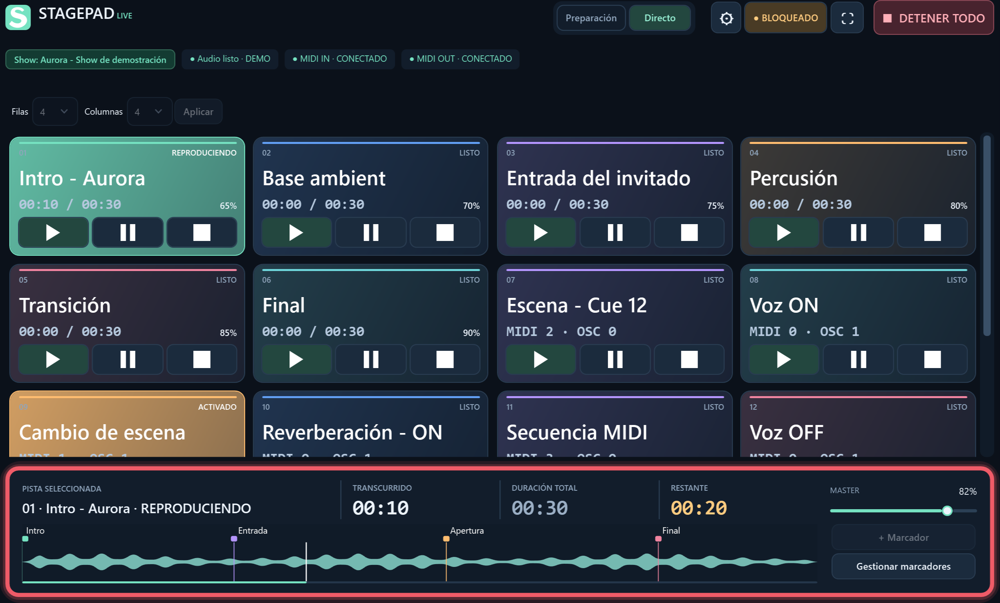
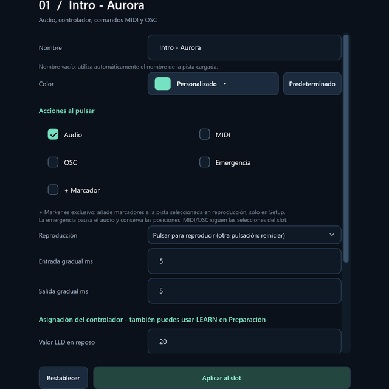
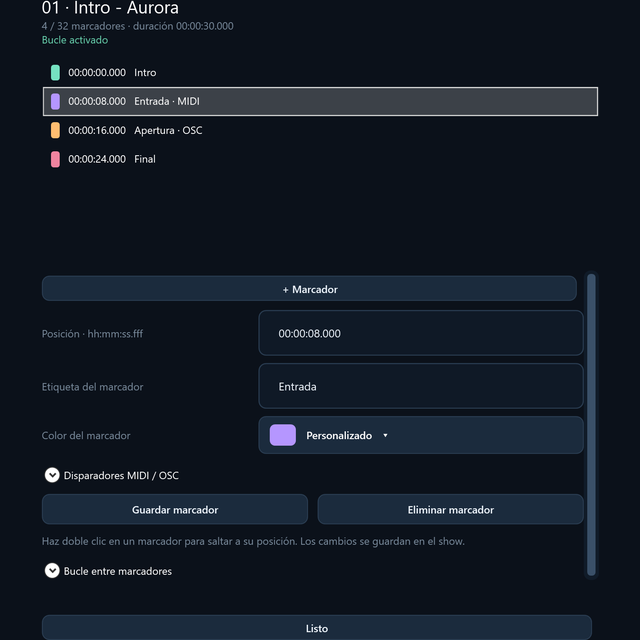
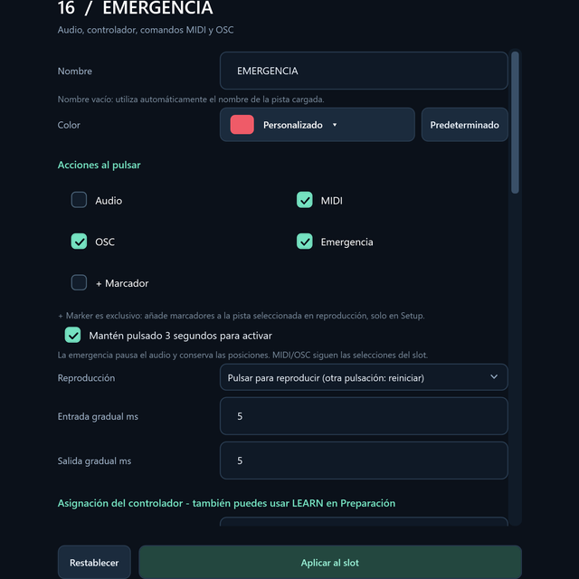
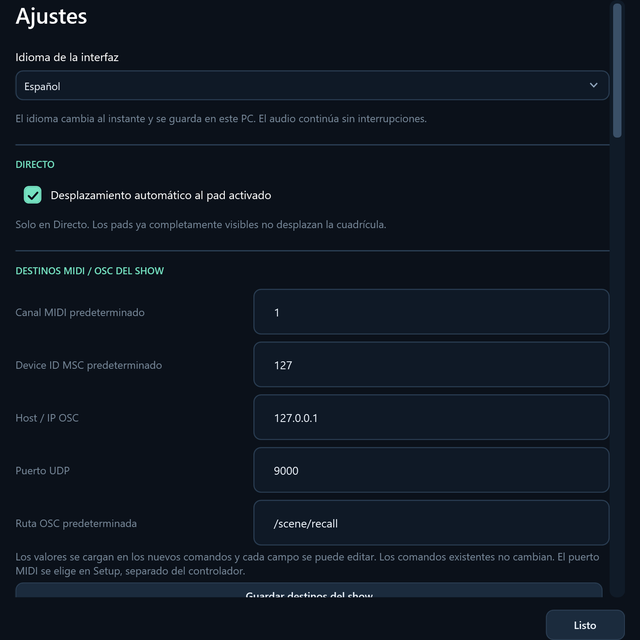
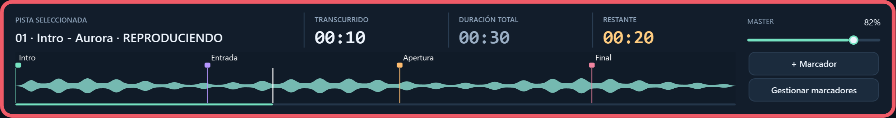
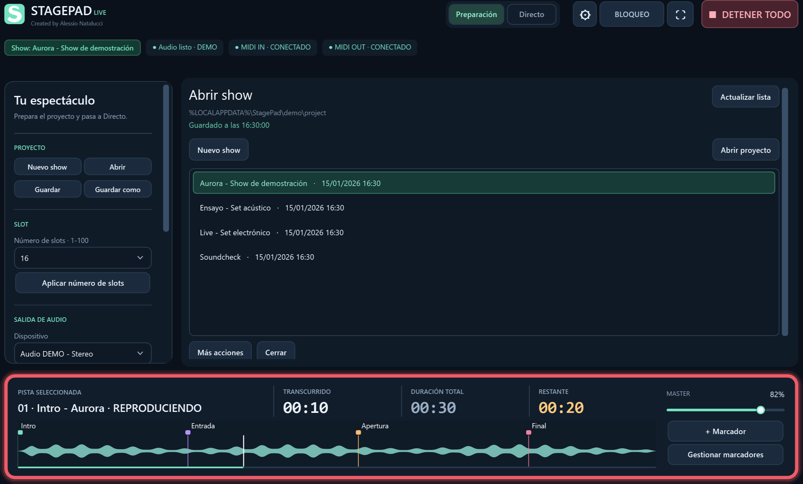

<h1> StagePad Live</h1>

Created by [@Alessio278](https://github.com/Alessio278)


**Lanzador de audio y controlador de cues MIDI/OSC para espectáculos en Windows.**

[](../LICENSE)   

[English](../README.md) - [Italiano](README.it.md) - [Español](README.es.md) - [Français](README.fr.md)


## [Protección de inicio de slots en 1.4](releases/v1.4.md)

## Audio en la versión 1.3

El presupuesto PCM inicial de un Show nuevo es un octavo de la memoria disponible indicada por .NET, entre 128 y 3072 MiB. Es un límite de uso. Los Shows existentes conservan el valor guardado. Las pistas de hasta 25 minutos pueden reproducirse íntegramente desde la RAM. Si hay poca memoria, StagePad prepara la lectura anticipada desde el disco. Si un pico supera el fondo de escala tras la conversión, se aplica una ganancia constante a toda la pista temporal. Master y Slot al 100% aplican ganancia unitaria. En directo, la parte reproducida aparece en dorado y el Loop en gris claro.

## Índice

- [Inicio rápido](#inicio-rápido)
- [Capturas de pantalla](#capturas-de-pantalla)
- [Funciones](#funciones)
- [Marcadores y bucles](#marcadores-y-bucles)
- [Shows y guardado](#shows-y-guardado)
- [MIDI y OSC](#midi-y-osc)
- [Compilación y pruebas](#compilación-y-pruebas)
- [Licencia y contribuciones](#licencia-y-contribuciones)
- [Windows SmartScreen](#windows-smartscreen)

## Inicio rápido

1. Descarga **StagePad-Live-1.4-Windows.zip** desde [Releases](https://github.com/Alessio278/StagePad-Live/releases), extráelo y ejecuta **StagePad-1.4.exe**. No requiere instalación.
2. En Setup elige el dispositivo de audio y los puertos MIDI. Empieza con un búfer de 40 ms y realiza la prueba de audio.
3. Carga las pistas, configura las acciones y asigna pads con LEARN. Selecciona el idioma desde el engranaje.
4. Guarda el show, cambia a Directo y activa SHOW LOCK. F11 abre la pantalla completa; STOP ALL detiene el audio y los comandos pendientes.

## Capturas de pantalla

Las imágenes se capturaron con la versión 1.1. Los nuevos límites de pista y la forma de onda gris claro del Loop de 1.2 aún no aparecen. Haz clic en una imagen para verla a tamaño completo.

<a href="screenshots/es/02-live.png"></a>

<table>
<tr>
<td align="center" width="50%"><strong>Slot Audio</strong><br><a href="screenshots/es/06-slot-audio.png"></a></td>
<td align="center" width="50%"><strong>Editor de Markers</strong><br><a href="screenshots/es/05-markers.png"></a></td>
</tr>
<tr>
<td align="center" width="50%"><strong>Protección de emergencia</strong><br><a href="screenshots/es/09-emergency.png"></a></td>
<td align="center" width="50%"><strong>Settings</strong><br><a href="screenshots/es/11-settings.png"></a></td>
</tr>
</table>

[Abrir la galería completa: 13 screenshots](screenshots/es/README.md)

## Funciones

| Área | Detalles |
| --- | --- |
| Pads | 1-100 slots; rejillas independientes Setup y Directo, hasta 10 x 10 |
| Audio | One-shot, Hold, protegido y reproducción/pausa; fundidos; volumen por slot y máster |
| Acciones | Audio, MIDI y OSC combinables, emergencia con pausa global o + Marker exclusivo |
| Controles | MIDI LEARN, CC separados para máster/pista, encoders relativos y captura suave |
| Shows | Nuevo, Abrir, Guardar, Guardar como, renombrar, duplicar, eliminar, autoguardado y exportación con audio |
| Interfaz | Italiano, inglés, español y francés; pads de colores, títulos desplazables y forma de onda |

### Novedades de 1.2

- Elige Markers existentes como inicio y/o fin de la pista. El Audio anterior o posterior queda fuera de la reproducción; el archivo original permanece intacto.
- En Gestionar marcadores selecciona Inicio de la pista y Fin de la pista, y pulsa Aplicar recorte. Detén primero el Slot. Restaurar pista completa elimina el recorte.
- Play y las siguientes activaciones comienzan dentro del intervalo seleccionado; los tiempos usan su duración efectiva. El Loop debe quedar dentro del recorte.
- La forma de onda dentro del Loop es de color gris claro. El Audio excluido se oscurece.

### Otras funciones

- Los shows nuevos empiezan sin acciones seleccionadas. Cargar una pista activa Audio.
- Los nuevos comandos MIDI/OSC precargan valores editables. Cambiar los valores predeterminados no modifica comandos existentes.
- Los volúmenes muestran porcentajes y conservan el último valor de ratón/MIDI al volver a activar y guardar. El valor predeterminado se aplica a nuevos slots; aplicarlo a todos exige pistas detenidas.
- Los pads configurados tienen un color tenue que se intensifica al activarlos. Los slots solo MIDI/OSC muestran comandos y estado.
- La emergencia puede exigir tres segundos de pulsación continua. Usa pads momentáneos Note On/Off para que soltar cancele la espera.
- Desplazamiento más lento con rueda/trackpad, casillas alineadas y etiqueta compacta +MARKER.

## Marcadores y bucles

Configura los límites en **Gestionar marcadores > Inicio y fin de la pista**. Elige un Marker para uno o ambos límites, o conserva **Inicio del archivo / Fin del archivo**. Detén el Slot antes de aplicar el recorte. Los Markers usados como límites no se pueden mover ni eliminar hasta restaurar la pista completa.

**+ Marker** en el reproductor añade en la posición del cursor sin abrir el editor durante la reproducción. **Gestionar marcadores** permite editar tiempo, etiqueta, color y triggers MIDI/OSC. Haz doble clic en la forma de onda o un marcador para saltar.

Un slot puede usar la acción exclusiva **+ Marker**. Otra tecla MIDI se asigna en **Ajustes > Inserción rápida de marcadores**. Ambos actúan sobre la pista seleccionada en reproducción, solo en Setup y sin SHOW LOCK.

Selecciona dos marcadores existentes y pulsa **Aplicar bucle**. La reproducción empieza en el primero; **Quitar bucle** elimina el intervalo. Detén la pista antes de cambiarlo. En el bucle el marco pulsa lentamente en rojo; fuera, cada marcador produce siete destellos de su color. Los comandos de los marcadores se envían en cada vuelta.

<a href="screenshots/es/03-player-marker.png"></a>

## Shows y guardado

Los shows se abren y guardan dentro de la app. El autoguardado está activado por defecto, trabaja en segundo plano y conserva el archivo anterior como `.bak`. Al iniciar restaura el último show sin reproducir audio.

La carpeta predeterminada es `%LOCALAPPDATA%\StagePad\project`, modificable en Ajustes. El JSON referencia las pistas; usa **Exportar show con audio** para transferir todo el show.

La versión 1.2 lee los esquemas Show 1-4 y guarda con esquema 4. Conserva una copia: las versiones 1.0 y 1.1 no abren el esquema 4.

## MIDI y OSC

Cada slot admite hasta 16 comandos MIDI y 16 OSC, con orden y esperas. Las dos listas avanzan independientemente. MIDI admite Note, CC, Program Change y MSC; OSC usa UDP con host, puerto, ruta y argumentos editables. El contador de envíos no confirma la recepción.

[MIDI](MIDI.es.md) - [OSC](OSC.es.md) - [Update](UPDATE.es.md)

<a href="screenshots/es/13-shows.png"></a>

## Compilación y pruebas

Para compilar necesitas Windows 10/11 x64 y .NET SDK 10. La descarga portátil incluye el runtime. WAV y OGG usan decodificadores incluidos; otros formatos dependen de los códecs de Windows.

```powershell
.\Build.ps1
```

El script ejecuta pruebas core y de integración simulada, compila la app, comprueba WPF en Windows y crea el ZIP. Completa la [lista de pruebas](TESTING.md) con tu equipo.

## Licencia y contribuciones

StagePad Live se distribuye con [licencia MIT](../LICENSE). Los avisos de dependencias están en [licenses](../licenses/) y en Ajustes. Consulta [CONTRIBUTING.md](../CONTRIBUTING.md), [SECURITY.md](../SECURITY.md) y el [historial](../CHANGELOG.md).

## Windows SmartScreen

El ejecutable no está firmado, por lo que Windows puede mostrar “Windows protegió su PC” o “Editor desconocido”. Descarga desde Releases oficiales y compara SHA-256 con `SHA256.txt`. Si confías en el archivo, Windows puede ofrecer **Más información > Ejecutar de todas formas**; los equipos administrados pueden bloquear esta opción.
