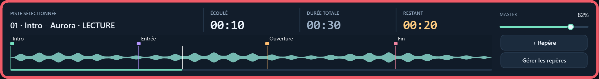
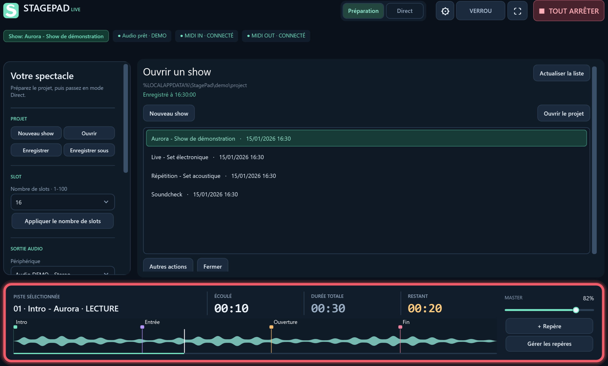
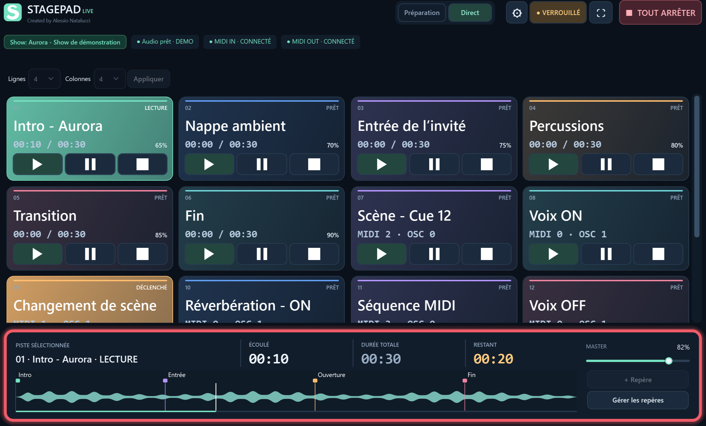
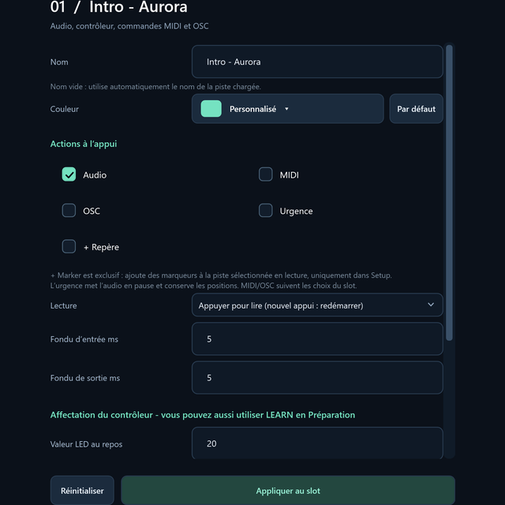
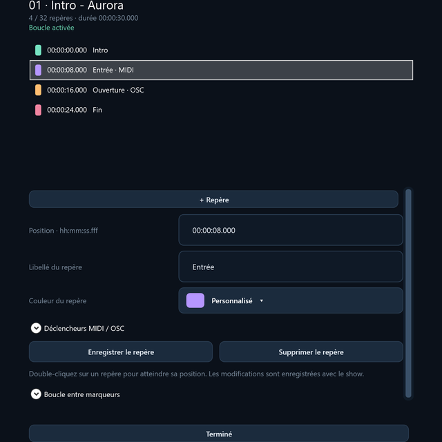
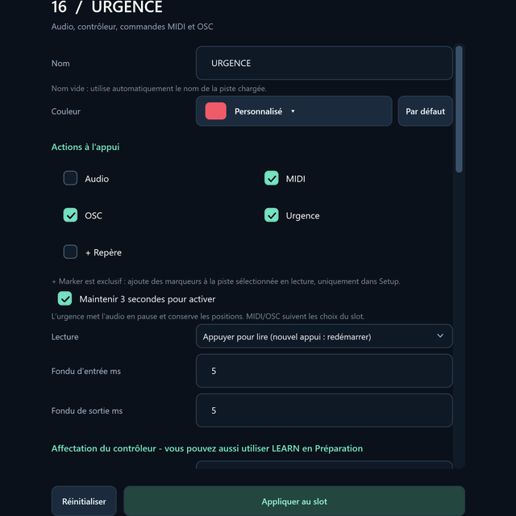
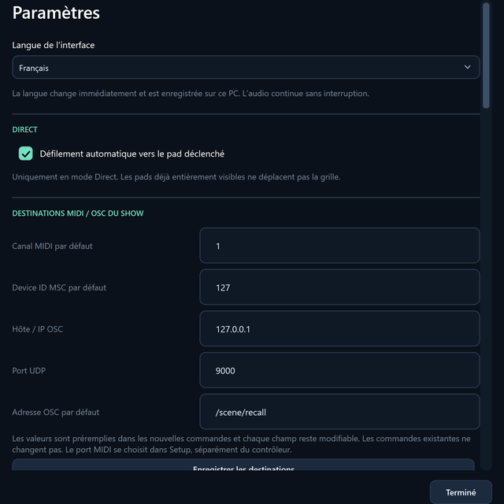

<h1> StagePad Live</h1>

Created by [@Alessio278](https://github.com/Alessio278)


StagePad Live permet de lancer des pistes audio et d’envoyer des commandes MIDI et OSC depuis un PC Windows. Préparez les pads dans la vue de configuration, puis passez en mode spectacle.

[](../LICENSE)   

[English](../README.md) - [Italiano](README.it.md) - [Español](README.es.md) - [Français](README.fr.md)

## What's New

Les notes de chaque version décrivent les changements depuis la version stable précédente. [Lire les notes de la dernière version](https://github.com/Alessio278/StagePad-Live/releases/latest)

## Sommaire

- [Démarrage rapide](#démarrage-rapide)
- [Fonctions](#fonctions)
- [Lecture audio](#lecture-audio)
- [Marqueurs et boucles](#marqueurs-et-boucles)
- [MIDI et OSC](#midi-et-osc)
- [Shows et sauvegarde](#shows-et-sauvegarde)
- [Captures d’écran](#captures-décran)
- [Windows SmartScreen](#windows-smartscreen)
- [Compilation et tests](#compilation-et-tests)
- [Licence et contributions](#licence-et-contributions)

## Démarrage rapide

1. Extrayez **StagePad-Live-1.4-Windows-Preview.zip** et lancez **StagePad-1.4.exe**.
2. Dans Setup, choisissez le périphérique audio et les ports MIDI. Commencez avec un tampon de 40 ms et lancez le test audio.
3. Chargez les pistes, configurez les actions et assignez les pads avec LEARN. Choisissez la langue depuis la roue dentée.
4. Enregistrez le show, passez en Direct et activez SHOW LOCK. F11 ouvre le plein écran ; STOP ALL arrête l’audio et les commandes en attente.

Ouvrez une copie de votre spectacle 1.3 pour essayer la 1.4. Cette version lit les anciens spectacles et les enregistre au format de schéma 5, y compris lors de la sauvegarde automatique. Gardez l’original pour la 1.3.

## Fonctions

| Domaine | Détails |
| --- | --- |
| Pads | 1-100 slots ; grilles Setup et Direct indépendantes, jusqu’à 10 x 10 |
| Audio | One-shot, Hold, protégé et lecture/pause ; fondus ; volumes par slot et master |
| Actions | Audio, MIDI et OSC combinables, Pause globale ou + Marker exclusif |
| Contrôles | MIDI LEARN, CC séparés pour master/piste, encodeurs relatifs et reprise progressive |
| Shows | Nouveau, Ouvrir, Enregistrer, Enregistrer sous, renommer, dupliquer, supprimer, sauvegarde automatique et export avec audio |
| Interface | Italien, anglais, espagnol et français ; pads colorés, titres défilants et forme d’onde |

### Options de déclenchement

- **Bloquer le lancement des autres pads audio.** Les pistes en cours continuent. Si vous appuyez sur un autre pad audio, son déclenchement et ses commandes MIDI et OSC sont ignorés.
- **Arrêter les autres slots audio au démarrage.** La nouvelle piste démarre immédiatement. Chaque piste sortante utilise son propre fondu.
- **Maintenir le pad pendant trois secondes.** Cette option s’applique aussi aux pads audio, MIDI et OSC. Relâchez le pad avant les trois secondes pour annuler. En MIDI, utilisez un pad momentané qui envoie Note Off.

## Lecture audio

Les pistes de 25 minutes au maximum peuvent être lues depuis la RAM si la mémoire allouée le permet. Sinon, StagePad prépare la lecture anticipée sur disque. La partie déjà lue apparaît en doré et la boucle en gris clair.

[Moteur audio et mémoire](AUDIO.md)

## Marqueurs et boucles

Réglez les limites dans **Gérer les marqueurs > Début et fin de la piste**. Choisissez un Marker pour une ou deux limites, ou gardez **Début du fichier / Fin du fichier**. Arrêtez le Slot avant d’appliquer la découpe. Les Markers utilisés comme limites ne peuvent être déplacés ni supprimés avant de restaurer la piste entière.

**+ Marker** dans le lecteur ajoute à la position du curseur sans ouvrir l’éditeur pendant la lecture. **Gérer les marqueurs** modifie le temps, le libellé, la couleur et les déclencheurs MIDI/OSC. Double-cliquez sur la forme d’onde ou un marqueur pour vous déplacer.

Un slot peut utiliser l’action exclusive **+ Marker**. Une autre touche MIDI s’assigne dans **Paramètres > Insertion rapide de marqueurs**. Les deux agissent sur la piste sélectionnée en lecture, uniquement dans Setup et sans SHOW LOCK.

Choisissez deux marqueurs existants et cliquez sur **Appliquer la boucle**. La lecture commence au premier ; **Retirer la boucle** supprime l’intervalle. Arrêtez la piste avant de changer la boucle. Dans une boucle, le cadre pulse lentement en rouge ; hors boucle, les marqueurs produisent sept flashs de leur couleur. Les commandes des marqueurs sont envoyées à chaque passage.

<a href="screenshots/fr/03-player-marker.png"></a>

## MIDI et OSC

Chaque slot prend en charge jusqu’à 16 commandes MIDI et 16 OSC, avec ordre et délais. Les deux listes avancent indépendamment. MIDI prend en charge Note, CC, Program Change et MSC ; OSC utilise UDP avec hôte, port, adresse et arguments modifiables. Le compteur d’envois ne confirme pas la réception.

[MIDI](MIDI.fr.md) - [OSC](OSC.fr.md) - [Update](UPDATE.fr.md)

## Shows et sauvegarde

Les shows s’ouvrent et s’enregistrent dans l’app. La sauvegarde automatique est active par défaut, travaille en arrière-plan et conserve le fichier précédent en `.bak`. Le démarrage restaure le dernier show sans lancer l’audio.

Le dossier par défaut est `%LOCALAPPDATA%\StagePad\project`, modifiable dans Paramètres. Le JSON référence les pistes ; utilisez **Exporter le show avec audio** pour transférer l’ensemble.

<a href="screenshots/fr/13-shows.png"></a>

## Captures d’écran

Ces captures présentent la version 1.1 avec des données de démonstration. Sélectionnez une image pour l’ouvrir en taille réelle.

<a href="screenshots/fr/02-live.png"></a>

<table>
<tr>
<td align="center" width="50%"><strong>Slot Audio</strong><br><a href="screenshots/fr/06-slot-audio.png"></a></td>
<td align="center" width="50%"><strong>Éditeur de Markers</strong><br><a href="screenshots/fr/05-markers.png"></a></td>
</tr>
<tr>
<td align="center" width="50%"><strong>Protection d’urgence</strong><br><a href="screenshots/fr/09-emergency.png"></a></td>
<td align="center" width="50%"><strong>Settings</strong><br><a href="screenshots/fr/11-settings.png"></a></td>
</tr>
</table>

[Ouvrir la galerie complète : 13 screenshots](screenshots/fr/README.md)

## Windows SmartScreen

L’exécutable n’est pas signé : Windows peut afficher “Windows a protégé votre ordinateur” ou “Éditeur inconnu”. Téléchargez depuis les Releases officielles et comparez SHA-256 à `SHA256.txt`. Si vous faites confiance au fichier, Windows peut proposer **Informations complémentaires > Exécuter quand même** ; les PC gérés peuvent bloquer cette option.

## Compilation et tests

La compilation nécessite Windows 10/11 x64 et .NET SDK 10. Le téléchargement portable inclut le runtime. WAV et OGG utilisent les décodeurs inclus ; les autres formats dépendent des codecs Windows.

```powershell
.\Build.ps1
```

Le script exécute les tests core et d’intégration simulée, compile l’app, vérifie WPF sous Windows et crée le ZIP. Complétez la [liste de tests](TESTING.md) avec votre matériel.

## Licence et contributions

StagePad Live est distribué sous [licence MIT](../LICENSE). Les notices des dépendances sont dans [licenses](../licenses/) et dans Paramètres. Consultez [CONTRIBUTING.md](../CONTRIBUTING.md), [SECURITY.md](../SECURITY.md) et l’[historique](../CHANGELOG.md).
