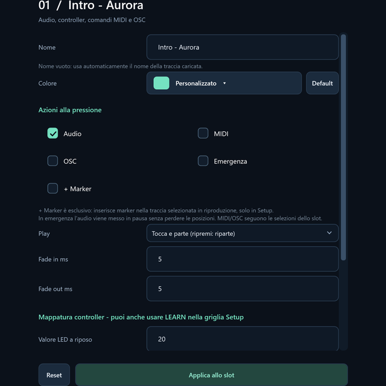
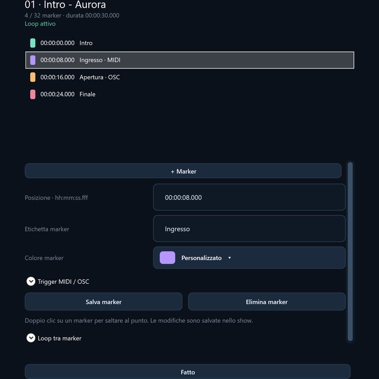
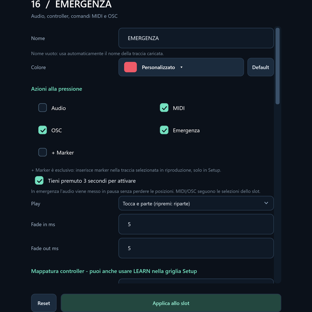
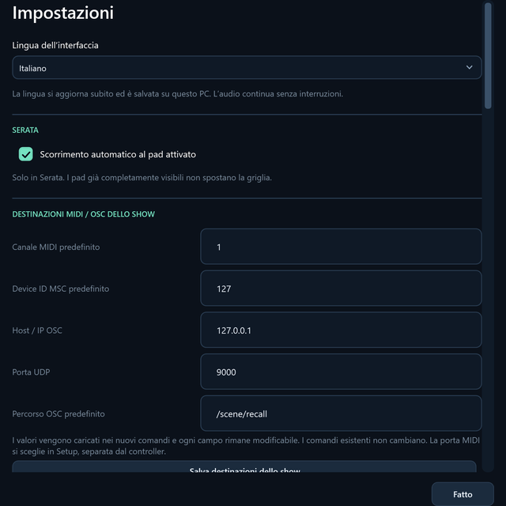

<h1> StagePad Live</h1>

Created by [@Alessio278](https://github.com/Alessio278)


**Launcher audio e controller di cue MIDI/OSC per spettacoli dal vivo su Windows.**

[](../LICENSE)   

[English](../README.md) - [Italiano](README.it.md) - [Español](README.es.md) - [Français](README.fr.md)


## [Protezione avvio slot nella 1.4](releases/v1.4.md)

## Audio nella 1.3

Per i nuovi Show il budget PCM iniziale è un ottavo della memoria utilizzabile indicata da .NET, tra 128 e 3072 MiB. È un tetto di spesa. Gli Show esistenti conservano il valore salvato. Le tracce fino a 25 minuti possono essere riprodotte interamente dalla RAM. Se la memoria scarseggia, StagePad prepara la lettura anticipata da disco prima della riproduzione. Se dopo la conversione un picco supera il fondo scala, un unico fattore riduce il livello di tutta la traccia temporanea. Master e Slot al 100% applicano guadagno unitario. In Serata la forma d’onda già ascoltata è dorata e il Loop resta grigio chiaro.

## Indice

- [Avvio rapido](#avvio-rapido)
- [Screenshot](#screenshot)
- [Funzioni](#funzioni)
- [Marker e loop](#marker-e-loop)
- [Show e salvataggio](#show-e-salvataggio)
- [MIDI e OSC](#midi-e-osc)
- [Compilazione e test](#compilazione-e-test)
- [Licenza e contributi](#licenza-e-contributi)
- [Windows SmartScreen](#windows-smartscreen)

## Avvio rapido

1. Scarica **StagePad-Live-1.4-Windows.zip** da [Releases](https://github.com/Alessio278/StagePad-Live/releases), estrailo e avvia **StagePad-1.4.exe**. Non serve installazione.
2. In Setup scegli dispositivo audio e porte MIDI. Parti da un buffer di 40 ms ed esegui il test audio.
3. Carica le tracce, configura le azioni degli slot e assegna i pad con LEARN. La lingua si sceglie dall’icona ingranaggio.
4. Salva lo show, passa a Serata e attiva SHOW LOCK. F11 apre lo schermo intero; STOP ALL ferma audio e comandi in attesa.

## Screenshot

Le immagini sono state acquisite con la 1.1. I nuovi limiti della traccia e la forma d’onda grigio chiaro del Loop della 1.2 non sono ancora mostrati. Clicca un’immagine per aprirla a dimensione intera.

<a href="screenshots/it/02-live.png"></a>

<table>
<tr>
<td align="center" width="50%"><strong>Slot Audio</strong><br><a href="screenshots/it/06-slot-audio.png"></a></td>
<td align="center" width="50%"><strong>Gestione Marker</strong><br><a href="screenshots/it/05-markers.png"></a></td>
</tr>
<tr>
<td align="center" width="50%"><strong>Protezione emergenza</strong><br><a href="screenshots/it/09-emergency.png"></a></td>
<td align="center" width="50%"><strong>Settings</strong><br><a href="screenshots/it/11-settings.png"></a></td>
</tr>
</table>

[Apri la galleria completa: 13 screenshot](screenshots/it/README.md)

## Funzioni

| Area | Dettagli |
| --- | --- |
| Pad | 1-100 slot; griglie indipendenti Setup e Serata, fino a 10 x 10 |
| Audio | Modalità One-shot, Hold, protetta e play/pausa; fade; volumi slot e master |
| Azioni | Audio, MIDI e OSC combinabili, emergenza con pausa globale oppure + Marker esclusivo |
| Controlli | MIDI LEARN, CC separati per master/traccia, encoder relativi e anti-salto |
| Show | Nuovo, Apri, Salva, Salva come, rinomina, duplica, elimina, auto-save ed esportazione con audio |
| Interfaccia | Italiano, inglese, spagnolo e francese; pad colorati, titoli scorrevoli e forma d’onda |

### Novità della 1.2

- Scegli Marker esistenti come inizio e/o fine traccia. L’Audio prima o dopo quei punti viene escluso dalla riproduzione; il file originale resta intatto.
- In Gestisci marker scegli Inizio traccia e Fine traccia, poi Applica taglio. Prima ferma lo Slot. Ripristina traccia intera rimuove il taglio.
- Play e le pressioni successive partono nel tratto scelto; tempi trascorso e rimanente usano la durata effettiva. Il Loop deve restare dentro il taglio.
- La forma d’onda dentro il Loop è grigio chiaro. L’Audio escluso viene oscurato.

### Altre funzioni

- Gli show nuovi partono senza azioni selezionate. Caricare una traccia abilita Audio.
- I nuovi comandi MIDI/OSC caricano valori predefiniti modificabili. Cambiare i predefiniti non modifica i comandi esistenti.
- I volumi mostrano le percentuali e conservano l’ultimo valore mouse/MIDI alle pressioni successive e nel salvataggio. Il predefinito vale per i nuovi slot; applicarlo a tutti richiede tracce ferme.
- I pad configurati hanno una tinta soffusa e un riscontro più intenso all’attivazione. Gli slot solo MIDI/OSC mostrano comandi e stato di attivazione.
- L’emergenza può richiedere tre secondi di pressione continua. Per annullarla al rilascio usa pad MIDI momentanei Note On/Off.
- Scorrimento rotella/touchpad più lento, checkbox allineati ed etichetta compatta +MARKER.

## Marker e loop

I limiti si impostano in **Gestisci marker > Inizio e fine traccia**. Scegli un Marker per uno o entrambi i limiti, oppure mantieni **Inizio file / Fine file**. Ferma lo Slot prima di applicare il taglio. I Marker usati come limiti non si possono spostare o eliminare finché non ripristini la traccia intera.

**+ Marker** nel player aggiunge alla posizione del cursore. Durante la riproduzione inserisce senza aprire finestre. **Gestisci marker** modifica posizione, etichetta, colore e trigger MIDI/OSC. Doppio clic su forma d’onda o marker per saltare a quel punto.

Uno slot può avere l’azione esclusiva **+ Marker**; un tasto MIDI aggiuntivo si assegna in **Impostazioni > Inserimento rapido marker**. Entrambi agiscono sulla traccia selezionata in riproduzione, solo in Setup e con SHOW LOCK disattivato.

Scegli due marker esistenti e premi **Applica loop**. La riproduzione parte dal primo marker; **Rimuovi loop** elimina l’intervallo. Ferma la traccia prima di cambiare il loop. Nel loop la cornice pulsa lentamente in rosso; fuori dal loop i marker producono sette lampeggi del proprio colore. I comandi dei marker vengono inviati a ogni passaggio nel loop.

<a href="screenshots/it/03-player-marker.png"></a>

## Show e salvataggio

Gli show si aprono e salvano nell’app. L’auto-save è attivo per default, scrive in background e conserva il file precedente come `.bak`. All’avvio si ripristina l’ultimo show senza avviare l’audio.

La cartella predefinita è `%LOCALAPPDATA%\StagePad\project`, modificabile nelle impostazioni. Il JSON contiene riferimenti alle tracce: per trasferire uno show completo usa **Esporta show con audio**.

La 1.2 legge gli schemi Show 1-4 e salva con schema 4. Conserva una copia: le versioni 1.0 e 1.1 non aprono lo schema 4.

## MIDI e OSC

Ogni slot supporta fino a 16 comandi MIDI e 16 OSC, con ordine e attese. Le due liste avanzano indipendentemente. MIDI supporta Note, CC, Program Change e MSC; OSC usa UDP con host, porta, percorso e argomenti modificabili. Il contatore degli invii non conferma la ricezione.

[MIDI](MIDI.it.md) - [OSC](OSC.it.md) - [Update](UPDATE.it.md)

<a href="screenshots/it/13-shows.png"></a>

## Compilazione e test

Per compilare servono Windows 10/11 x64 e .NET SDK 10. Il pacchetto portatile include il runtime. WAV e OGG usano decoder inclusi; gli altri formati dipendono dai codec Windows.

```powershell
.\Build.ps1
```

Lo script esegue test core e di integrazione simulata, compila l’app, verifica WPF su Windows e crea lo ZIP. Completa la [checklist di test](TESTING.md) con l’attrezzatura dello show.

## Licenza e contributi

StagePad Live è distribuito con [licenza MIT](../LICENSE). Le licenze delle dipendenze sono in [licenses](../licenses/) e nelle impostazioni. Per contribuire: [CONTRIBUTING.md](../CONTRIBUTING.md), [SECURITY.md](../SECURITY.md) e [changelog](../CHANGELOG.md).

## Windows SmartScreen

L’eseguibile non è firmato: Windows può mostrare “PC protetto da Windows” o “Editore sconosciuto”. Scarica dalla pagina Releases ufficiale e confronta SHA-256 con `SHA256.txt`. Se ritieni attendibile il file, Windows può offrire **Ulteriori informazioni > Esegui comunque**; sui PC gestiti l’opzione può essere bloccata.
