# StagePad Live 1.1 - Screenshots

[Back to the documentation](../../../README.md)

[Italiano](../it/README.md) · [English](../en/README.md) · [Español](../es/README.md) · [Français](../fr/README.md)

Actual StagePad Live interface captures using isolated demonstration data. No real audio devices, MIDI or OSC endpoints are used. The images contain only application content, without the Windows title bar.

Technical labels such as MIDI, OSC, Setup, Live, Loop, Marker and LEARN remain in English.

### Setup - tracks, commands and colors

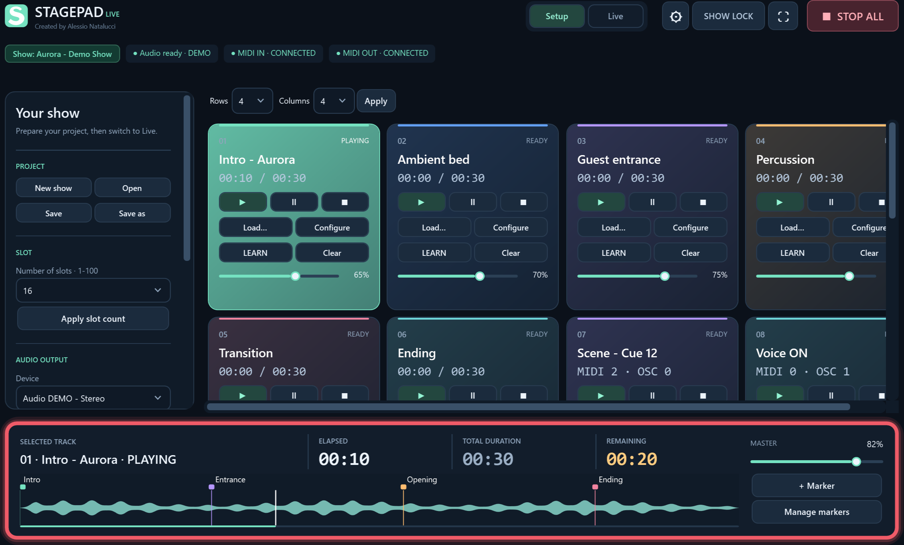

### Live - configured Pads and command feedback

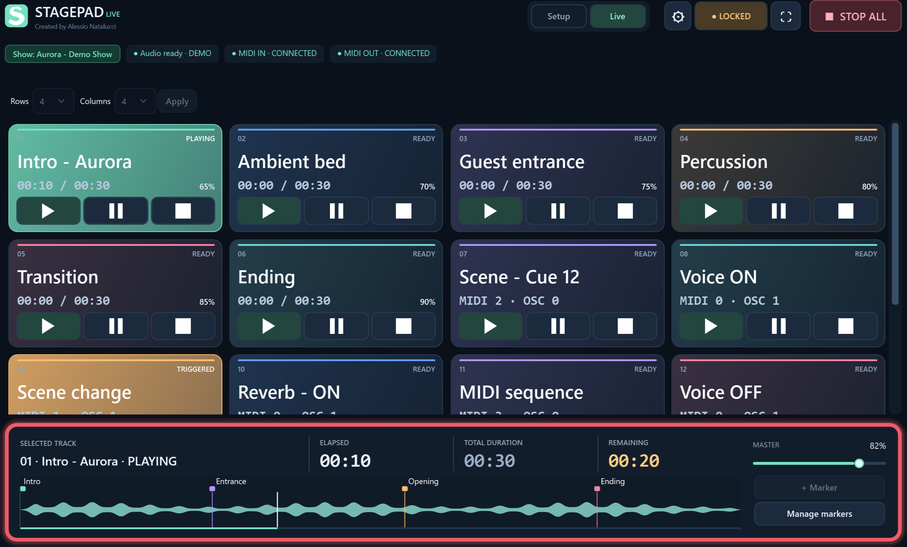

### Player - waveform and colored Markers

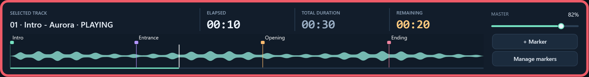

### Player - Loop between two Markers

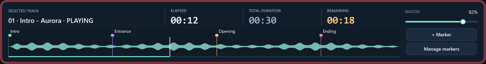

### Markers - label, color and Loop

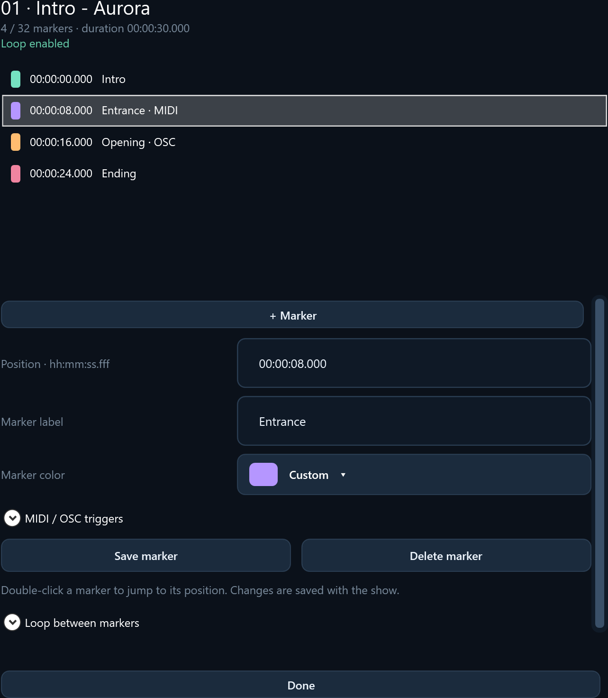

### Audio Slot - track configuration

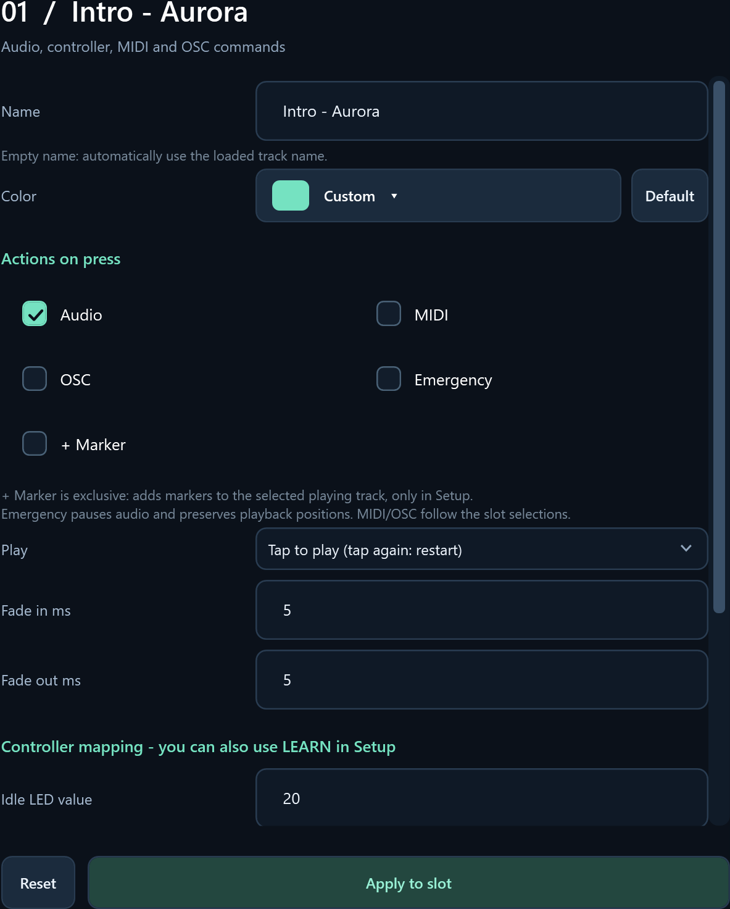

### MIDI Slot - editor (partial view)

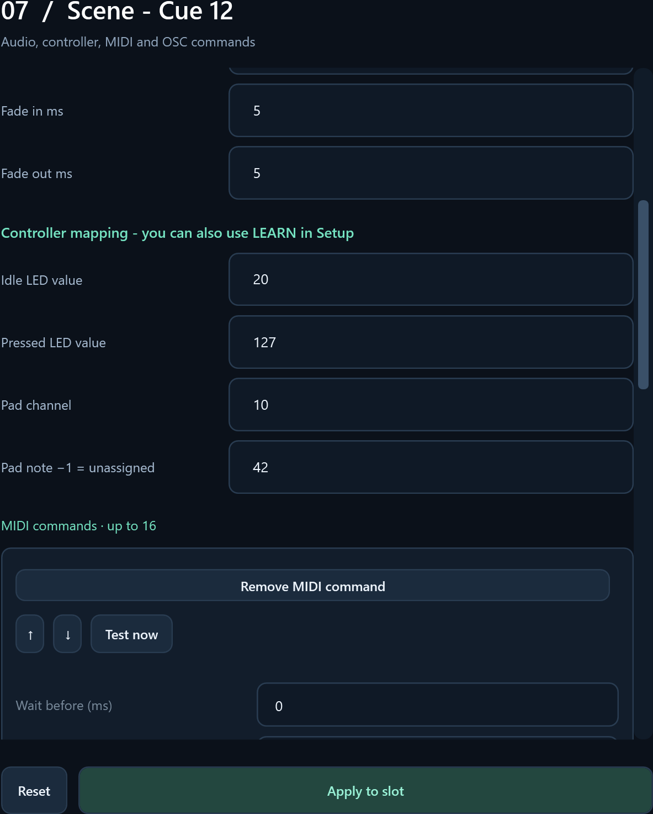

### OSC Slot - editor (partial view)

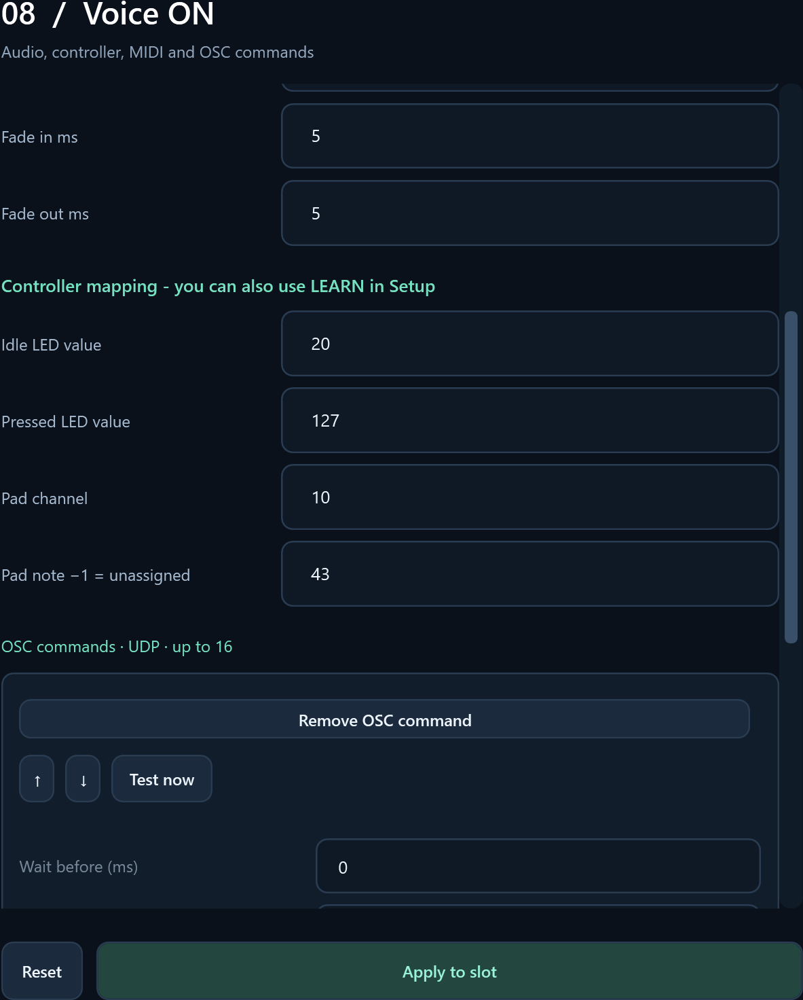

### Emergency - three-second hold protection

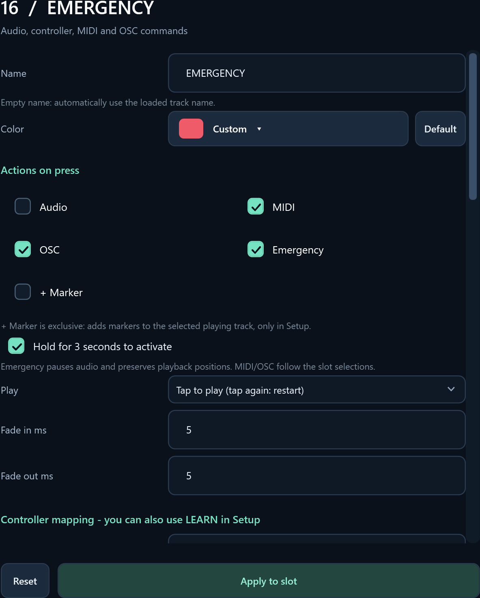

### + Marker Slot - exclusive action

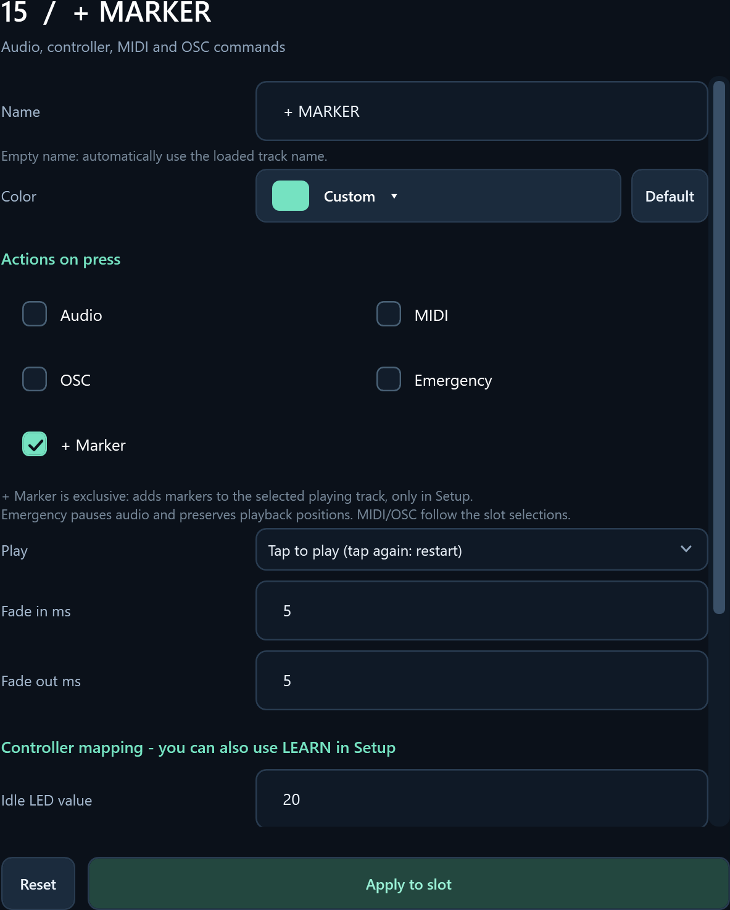

### Settings - language and default destinations

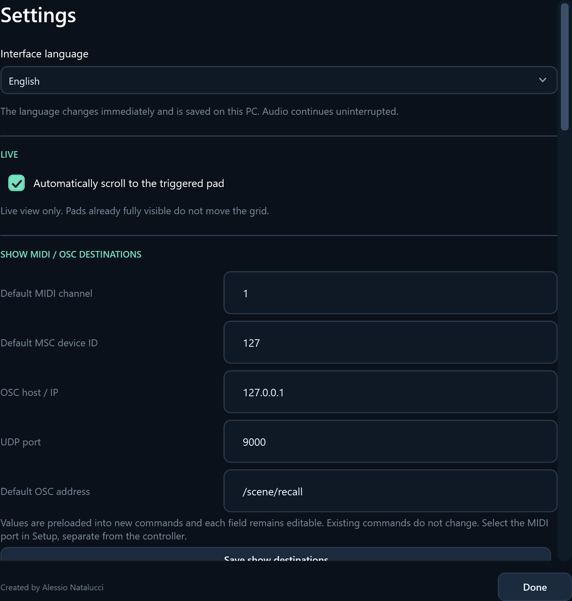

### MIDI volumes - Master and track with LEARN

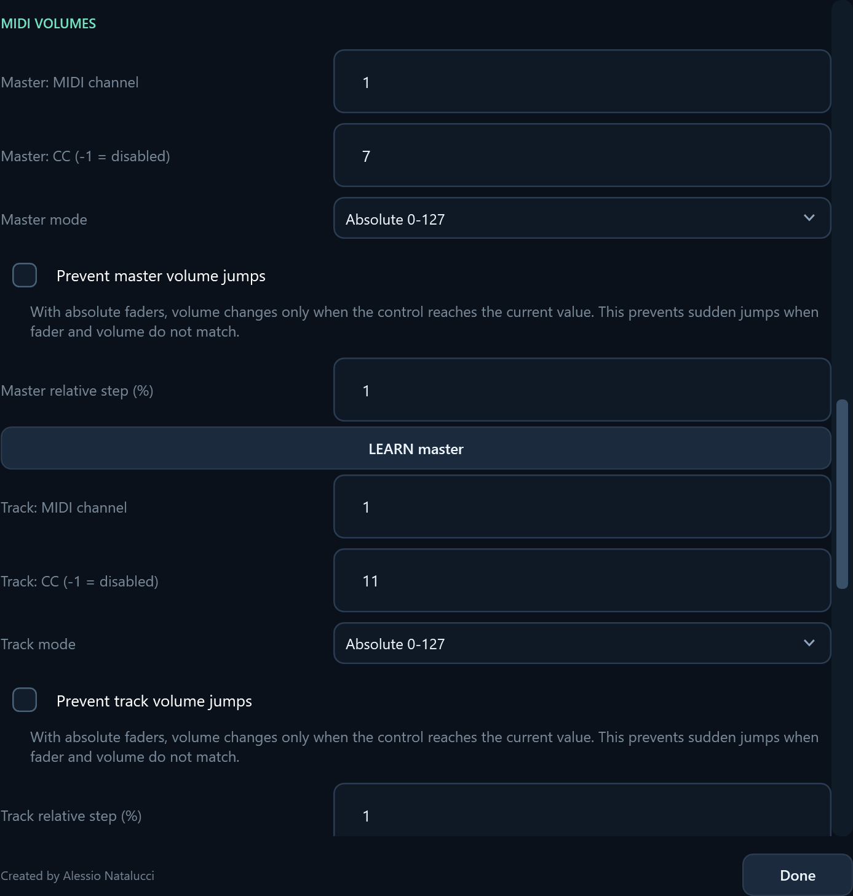

### Shows - demo project list

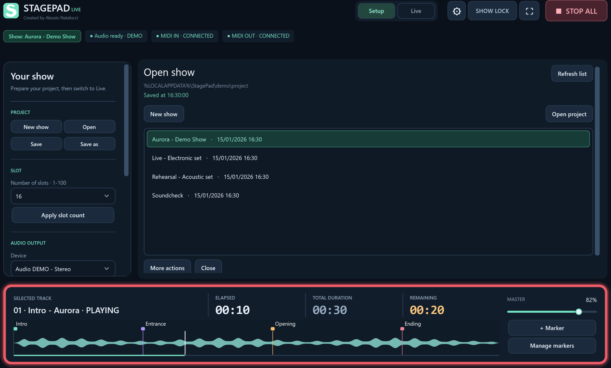

