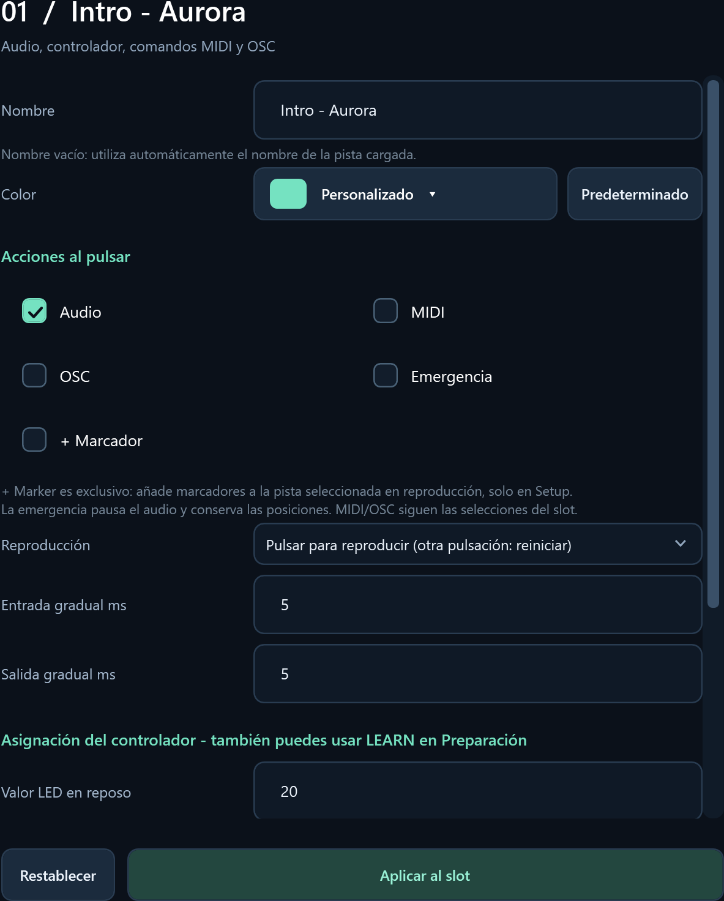
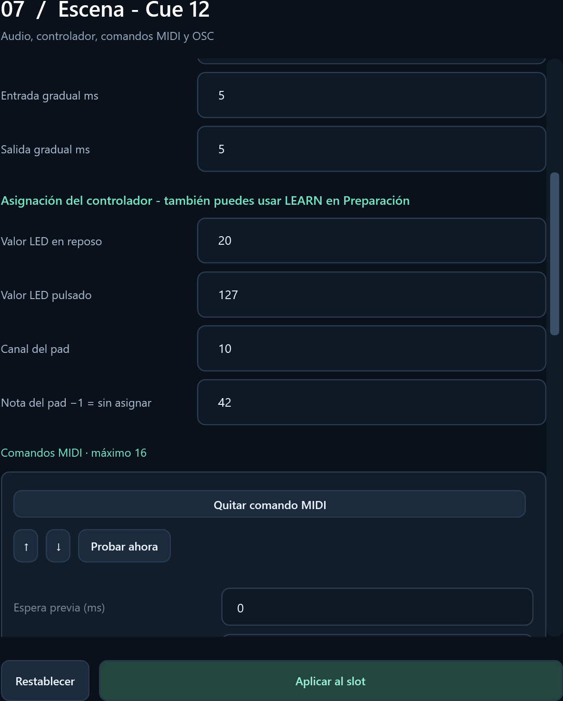
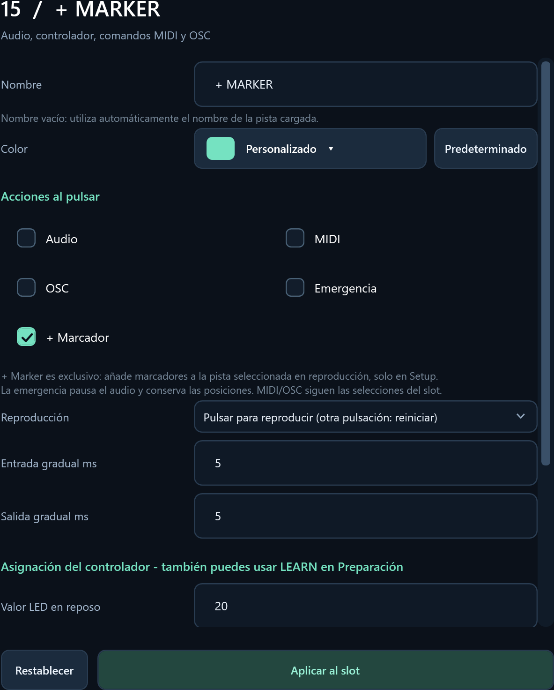
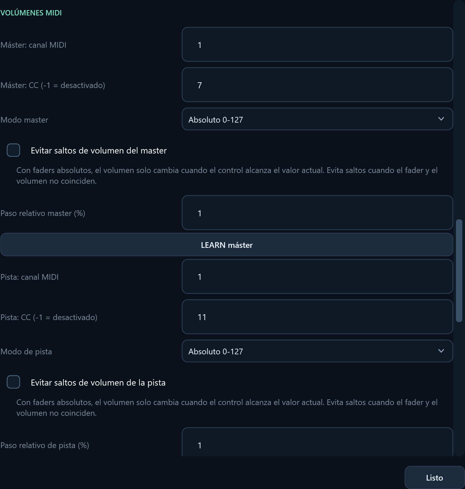

# StagePad Live 1.1 - Capturas de pantalla

[Volver a la documentación](../../README.es.md)

[Italiano](../it/README.md) · [English](../en/README.md) · [Español](../es/README.md) · [Français](../fr/README.md)

Las capturas muestran la versión 1.1 con datos de demostración.

## Setup - pistas, comandos y colores

## Live - Pads configurados y respuesta de los comandos

## Player - forma de onda y Markers de colores

## Player - Loop entre dos Markers

## Markers - etiqueta, color y Loop

## Slot Audio - configuración de la pista

## Slot MIDI - secuencia y esperas

## Slot OSC - comandos y esperas

## Emergencia - protección con pulsación de tres segundos

## Slot + Marker - acción exclusiva

## Settings - idioma y destinos predeterminados

## Volúmenes MIDI - Master y pista con LEARN

## Shows - lista de proyectos de demostración

