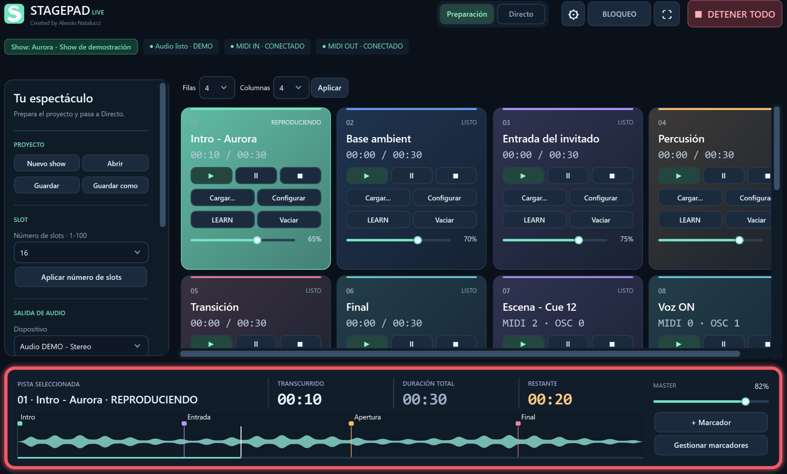
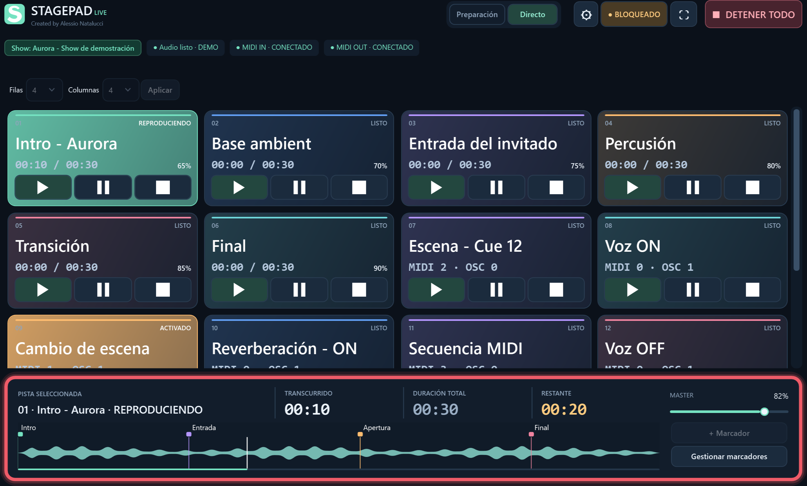
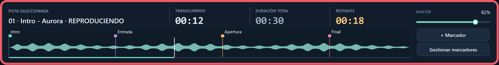
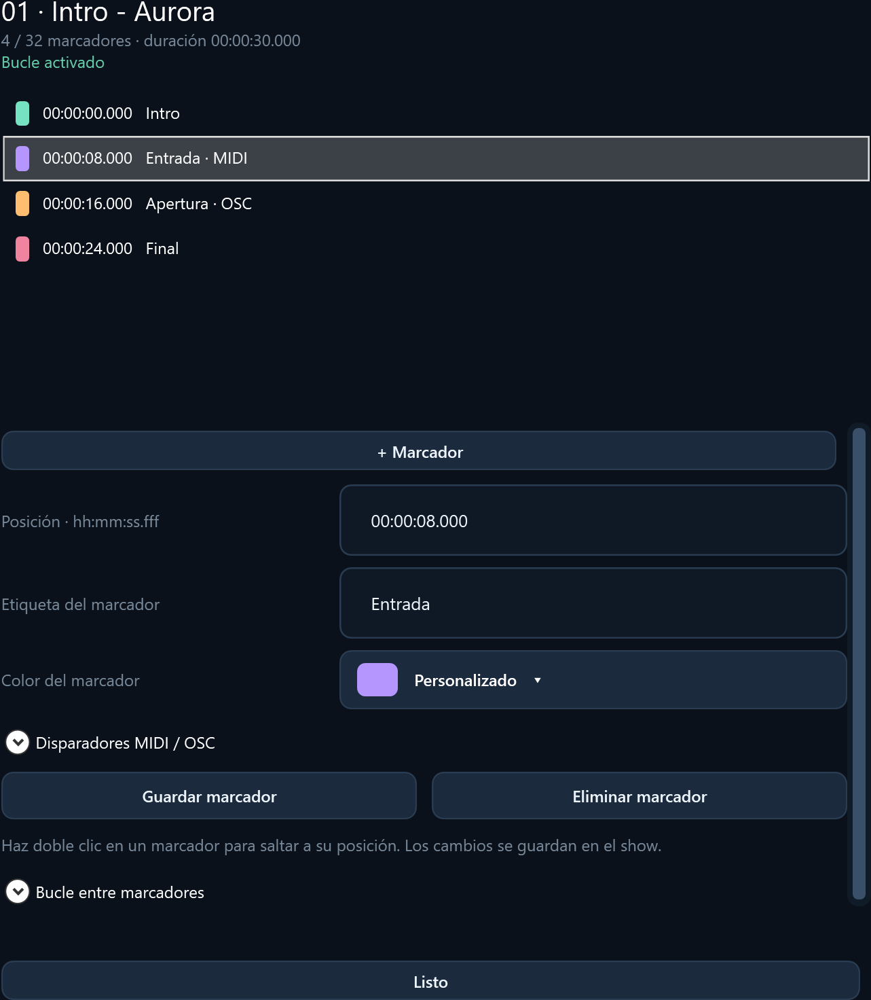
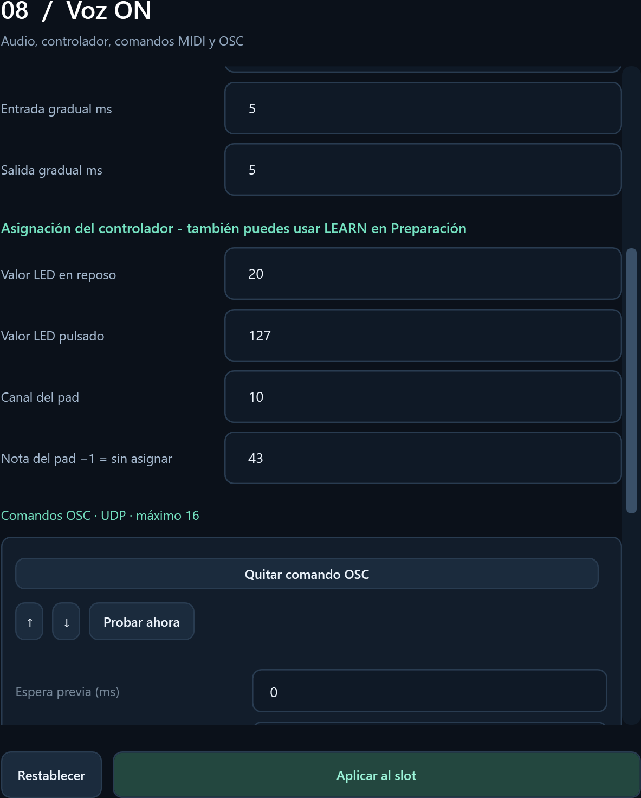
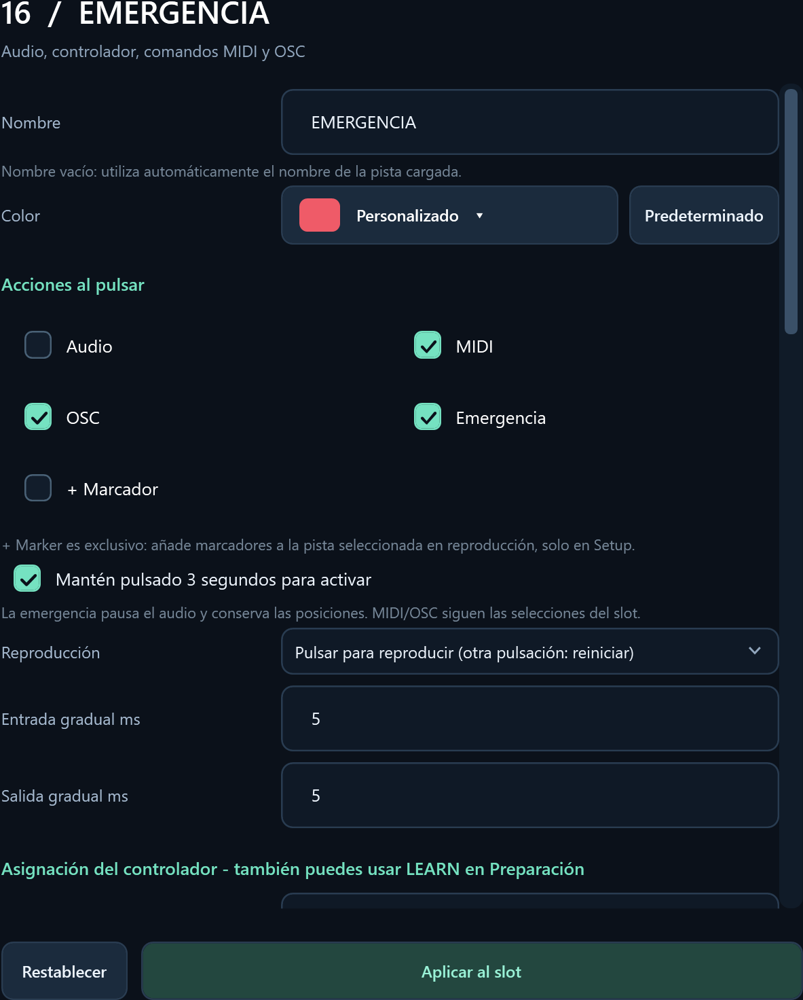
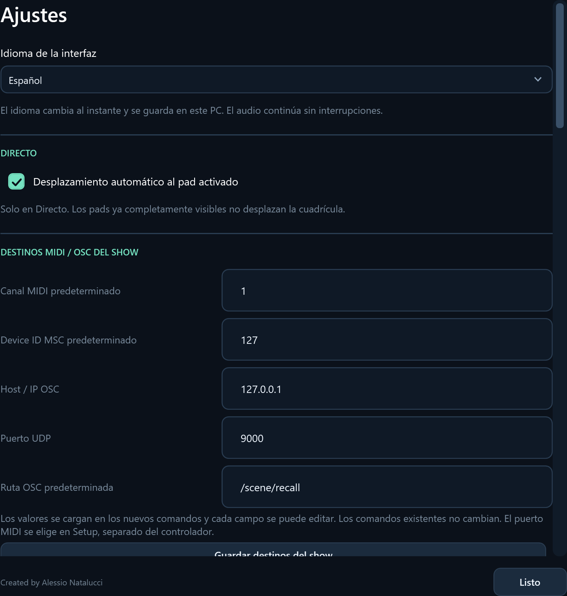
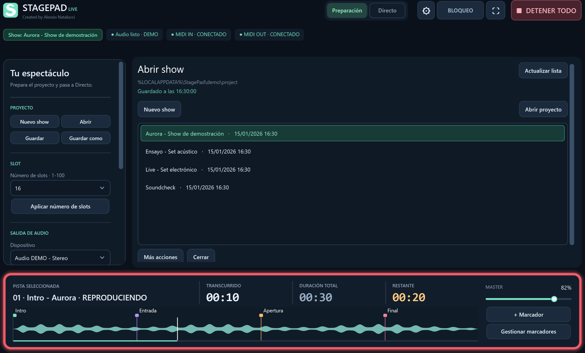

# StagePad Live 1.1 - Capturas de pantalla

[Volver a la documentación](../../README.es.md)

[Italiano](../it/README.md) · [English](../en/README.md) · [Español](../es/README.md) · [Français](../fr/README.md)

Capturas de la interfaz original de StagePad Live con datos de demostración aislados. No se utilizan dispositivos de audio, MIDI ni OSC reales. Las imágenes muestran únicamente la aplicación, sin la barra del sistema operativo.

Los términos técnicos universales como MIDI, OSC, Setup, Live, Loop, Marker y LEARN se mantienen en inglés.

### Setup - pistas, comandos y colores

### Live - Pads configurados y respuesta de los comandos

### Player - forma de onda y Markers de colores

### Player - Loop entre dos Markers

### Markers - etiqueta, color y Loop

### Slot Audio - configuración de la pista

### Slot MIDI - editor (vista parcial)

### Slot OSC - editor (vista parcial)

### Emergencia - protección con pulsación de tres segundos

### Slot + Marker - acción exclusiva

### Settings - idioma y destinos predeterminados

### Volúmenes MIDI - Master y pista con LEARN

### Shows - lista de proyectos de demostración

