# StagePad Live 1.1 - Captures d’écran

[Retour à la documentation](../../README.fr.md)

[Italiano](../it/README.md) · [English](../en/README.md) · [Español](../es/README.md) · [Français](../fr/README.md)

Ces captures présentent la version 1.1 avec des données de démonstration.

## Setup - pistes, commandes et couleurs

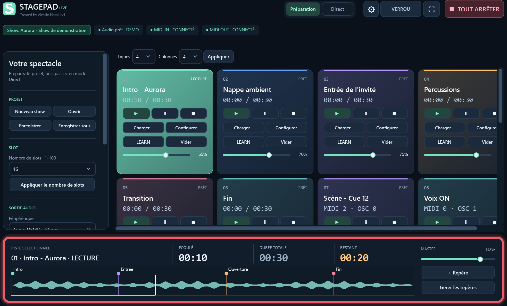

## Live - Pads configurés et retour des commandes

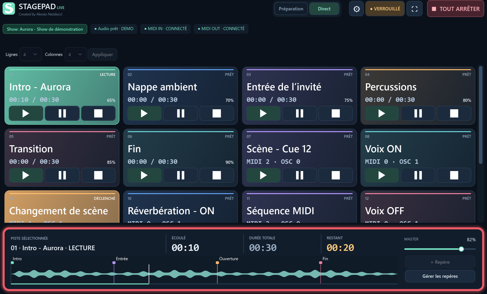

## Player - forme d’onde et Markers colorés

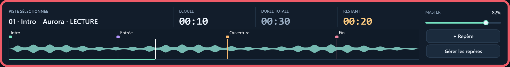

## Player - Loop entre deux Markers

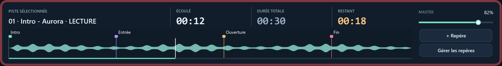

## Markers - libellé, couleur et Loop

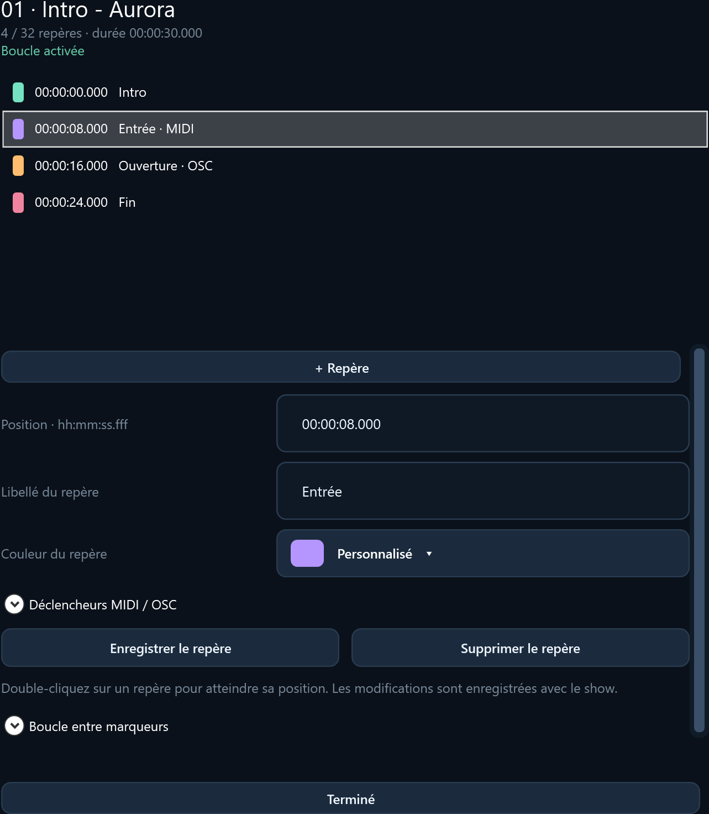

## Slot Audio - configuration de la piste

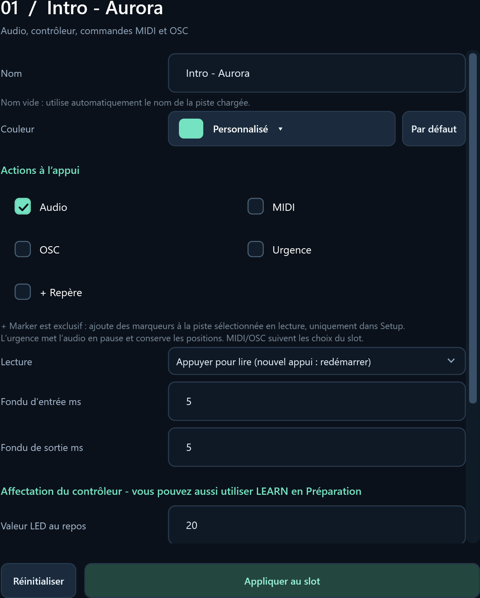

## Slot MIDI - séquence et délais

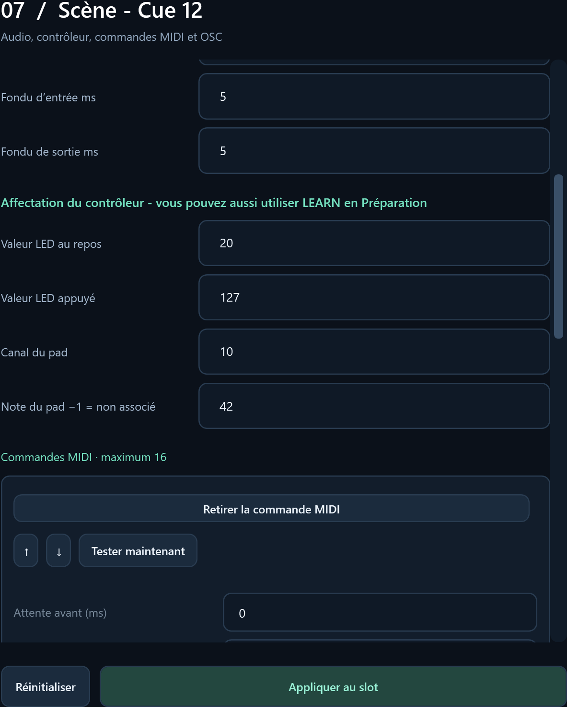

## Slot OSC - commandes et délais

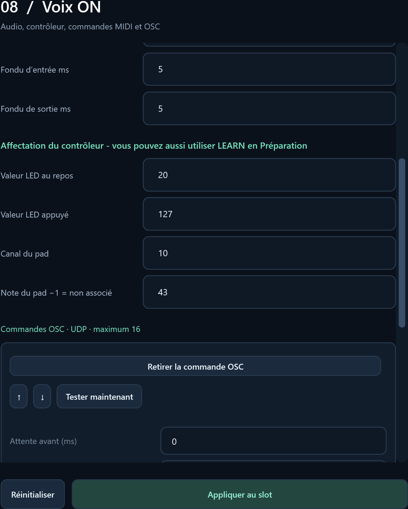

## Urgence - protection par maintien de trois secondes

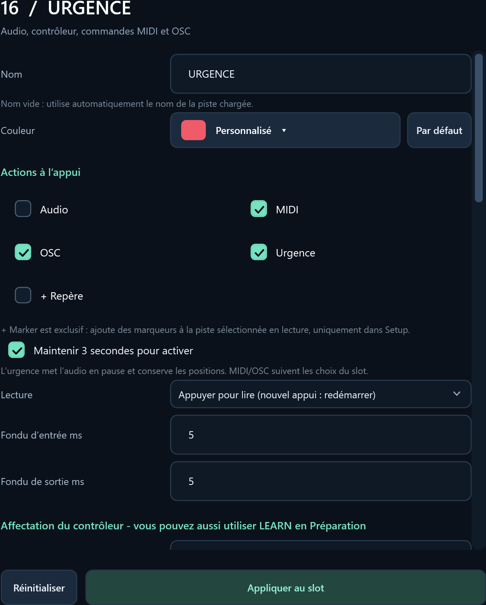

## Slot + Marker - action exclusive

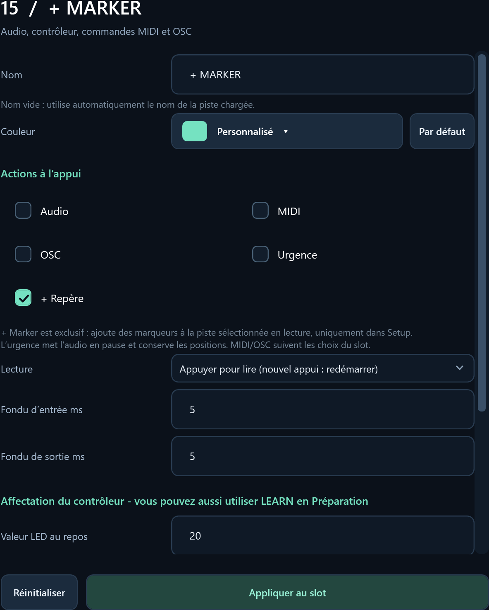

## Settings - langue et destinations par défaut

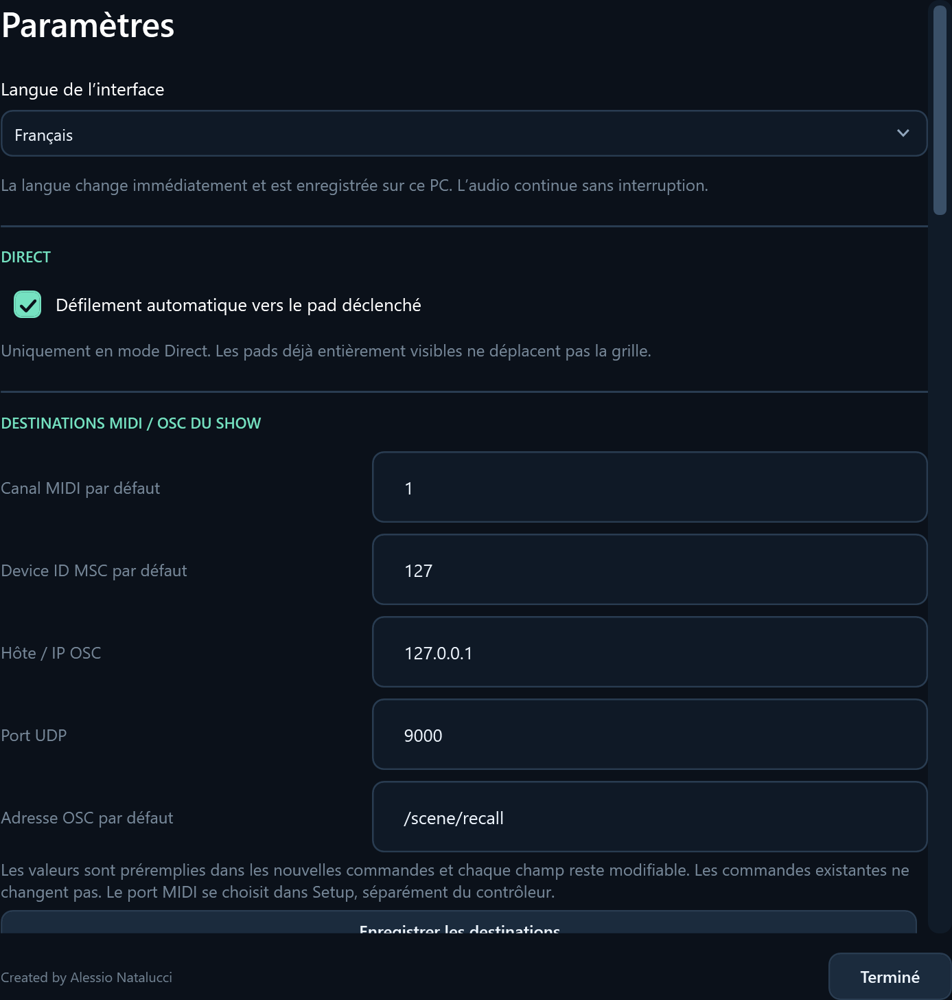

## Volumes MIDI - Master et piste avec LEARN

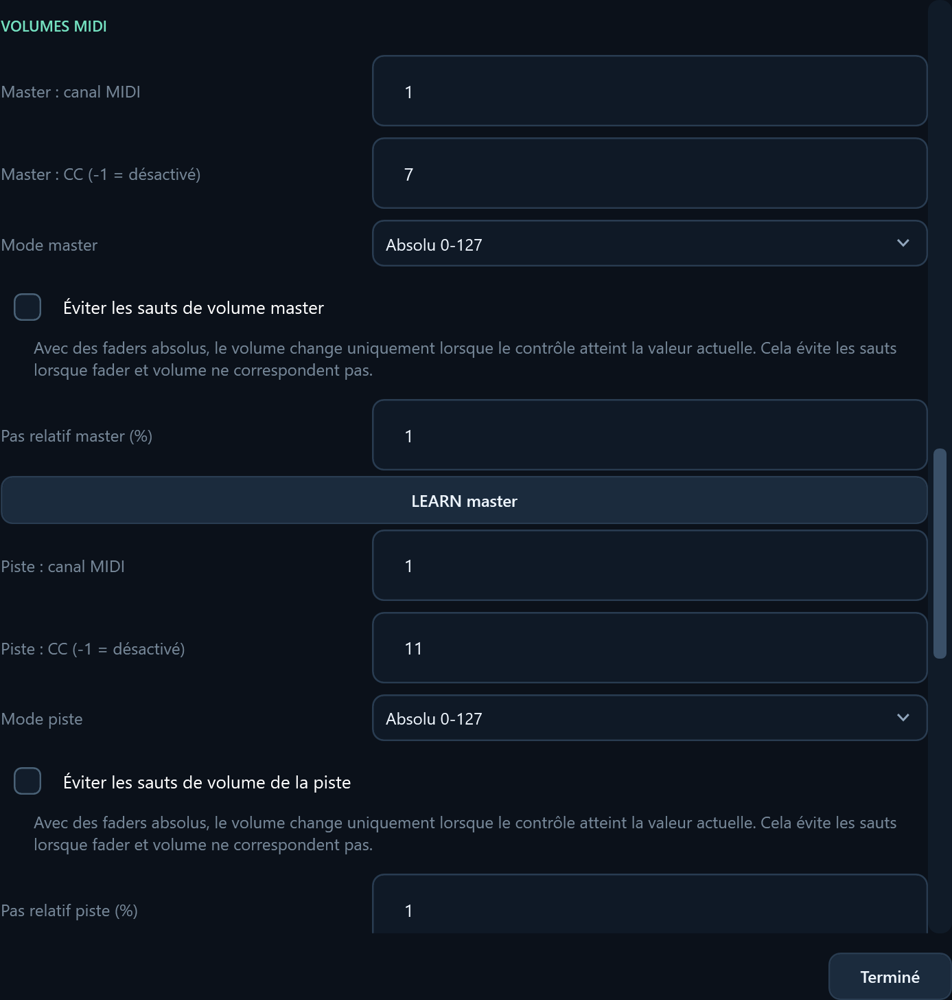

## Shows - liste des projets de démonstration

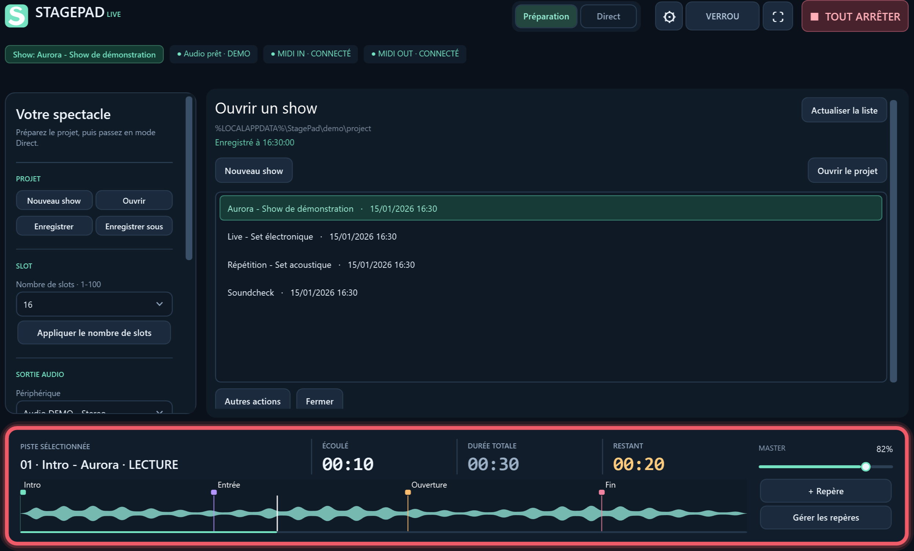
