# StagePad Live 1.1 - Screenshot

[Torna alla documentazione](../../README.it.md)

[Italiano](../it/README.md) · [English](../en/README.md) · [Español](../es/README.md) · [Français](../fr/README.md)

Schermate dell’interfaccia originale di StagePad Live con dati dimostrativi isolati. Non vengono utilizzati dispositivi audio, MIDI o OSC reali. Le immagini mostrano solo il contenuto dell’app, senza la barra del sistema operativo.

I termini tecnici universali come MIDI, OSC, Setup, Live, Loop, Marker e LEARN rimangono in inglese.

### Setup - tracce, comandi e colori

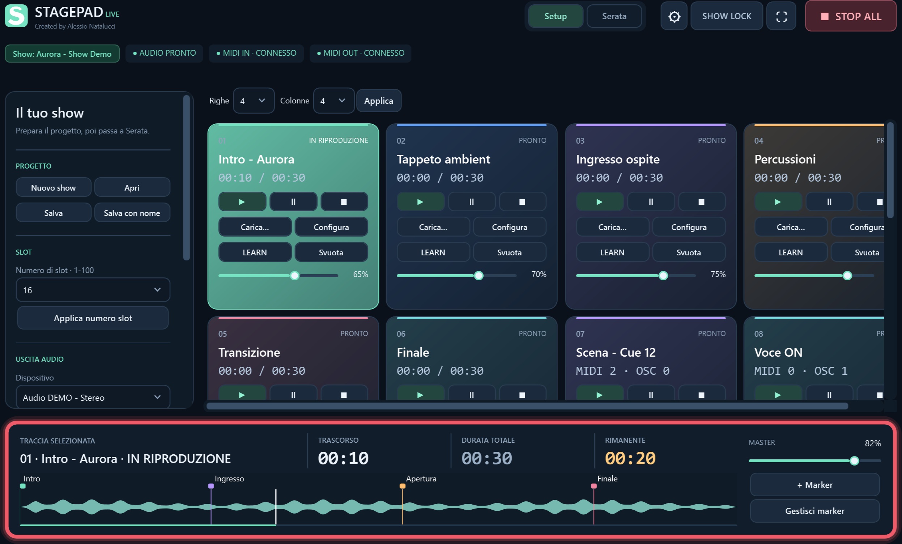

### Live - Pad configurati e riscontro dei comandi

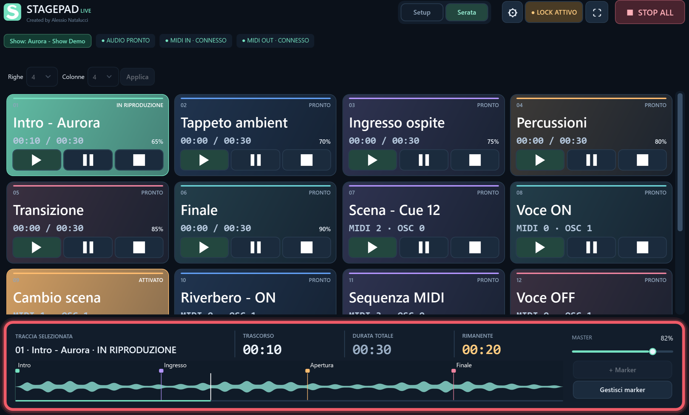

### Player - forma d’onda e Marker colorati

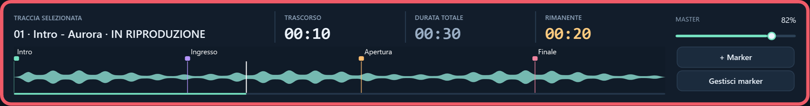

### Player - Loop tra due Marker

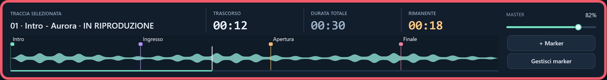

### Marker - etichetta, colore e Loop

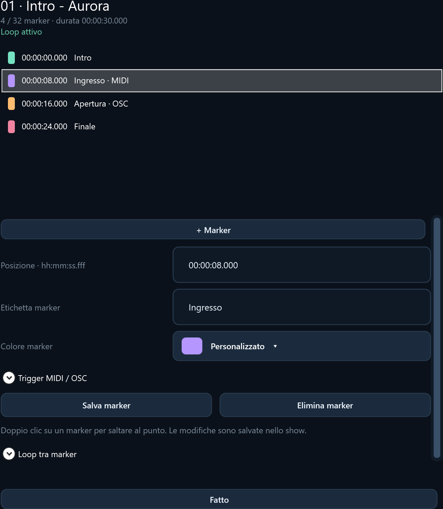

### Slot Audio - configurazione della traccia

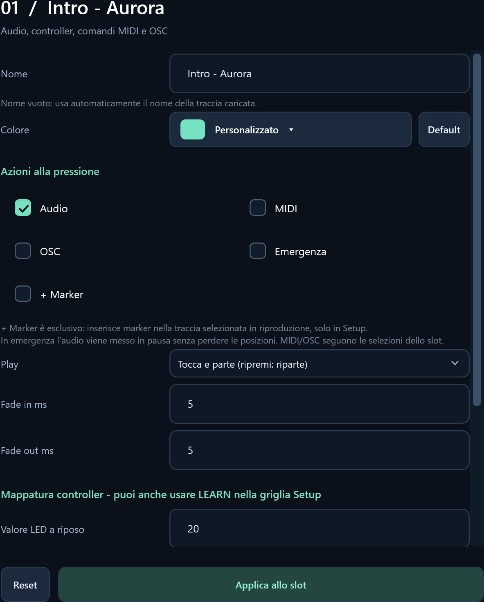

### Slot MIDI - editor (vista parziale)

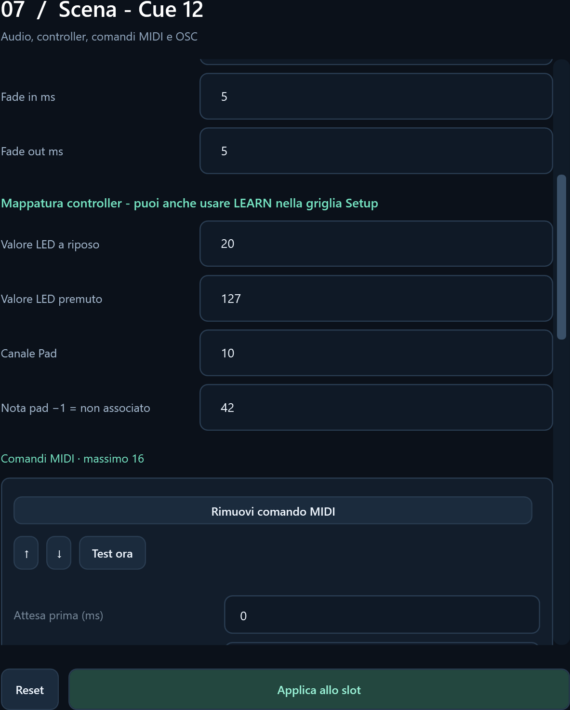

### Slot OSC - editor (vista parziale)

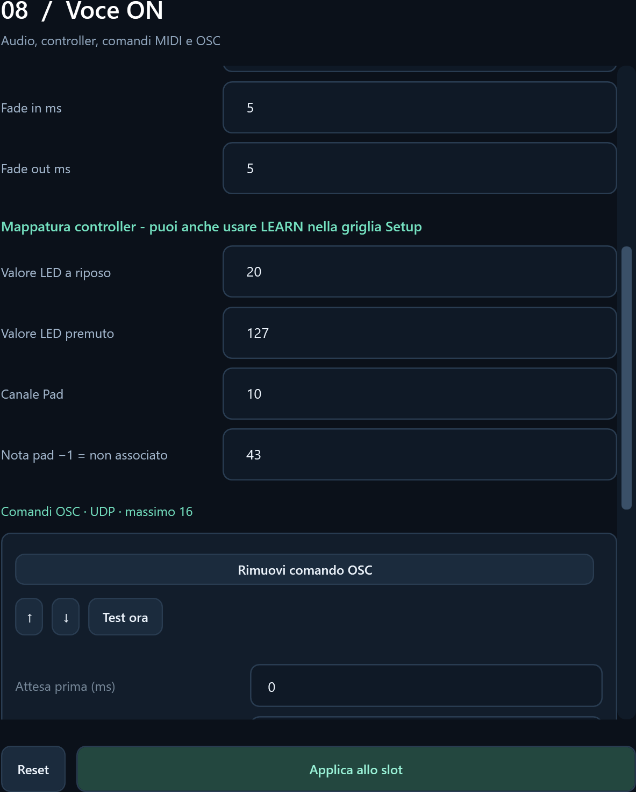

### Emergenza - protezione con pressione di tre secondi

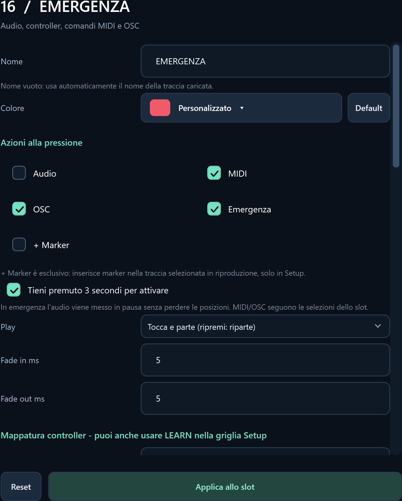

### Slot + Marker - azione esclusiva

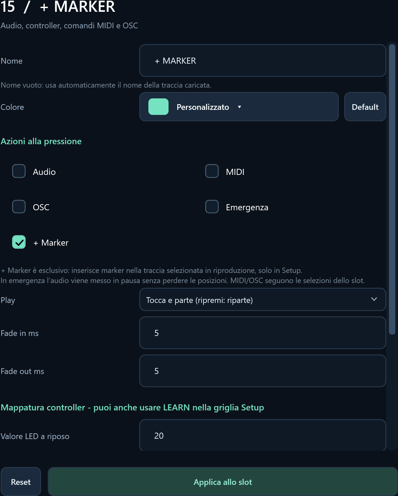

### Settings - lingua e destinazioni predefinite

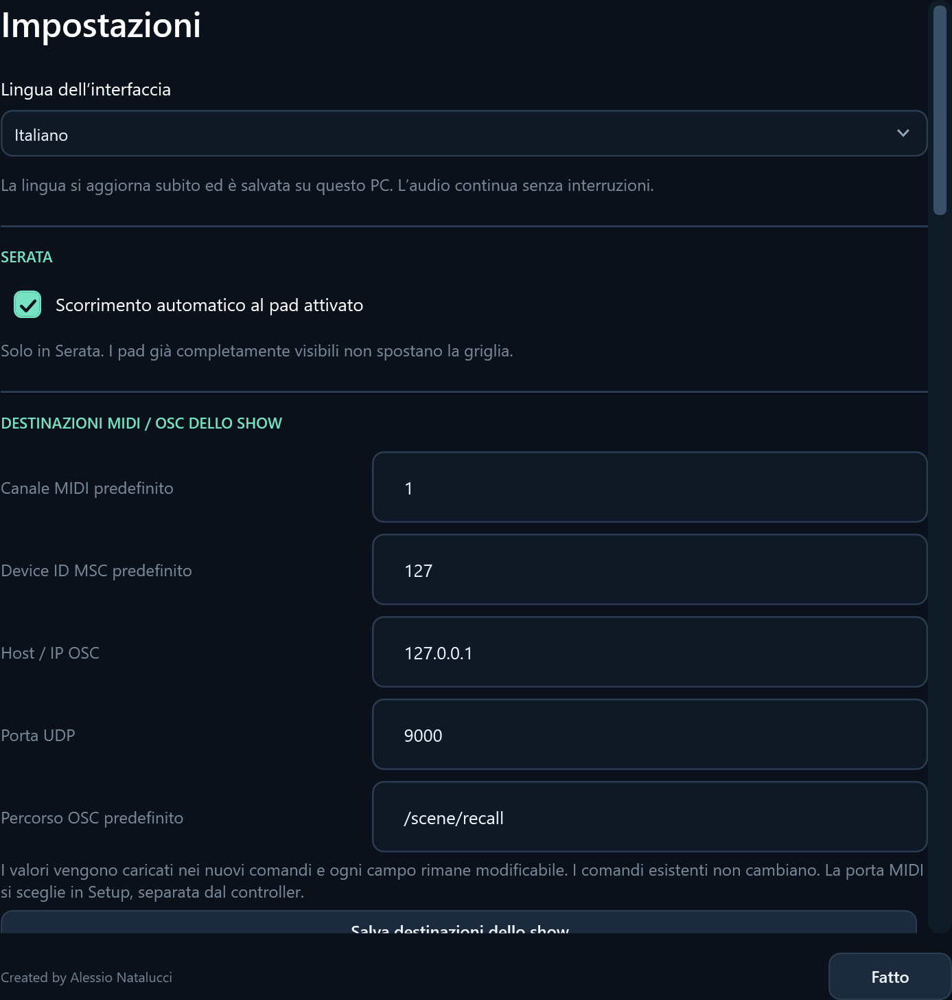

### Volumi MIDI - Master e traccia con LEARN

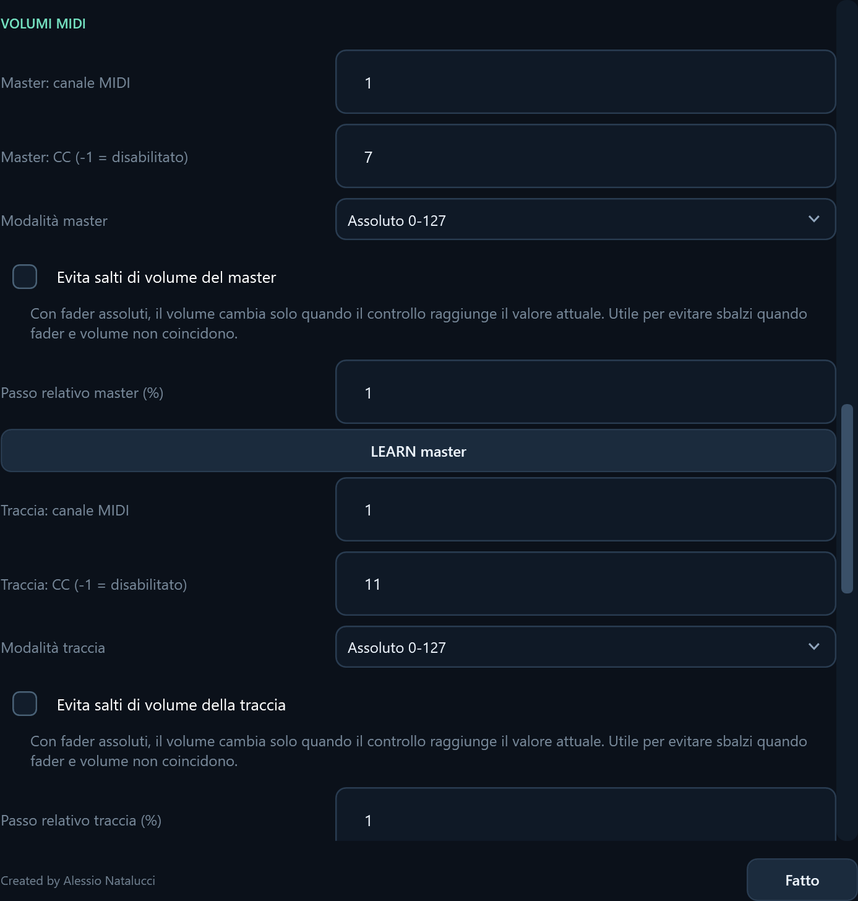

### Show - elenco dei progetti dimostrativi

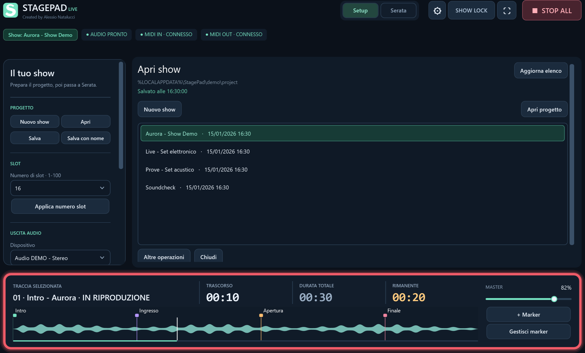

